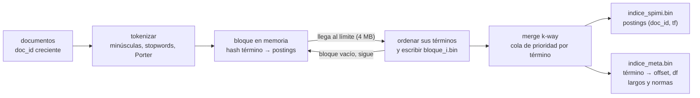

# Búsqueda de texto: SPIMI, TF-IDF y BM25

## Preprocesamiento

`motor/texto/preprocesamiento.h` implementa `tokenizar(texto)` para el dataset ABO en
inglés:

1. Convierte a minúsculas y translitera vocales latinas acentuadas, `ñ` y `ç`.
2. Usa los signos y cualquier carácter no ASCII restante como separadores.
3. Quita las palabras de `datos/stopwords_en.txt` (una por línea).
4. Aplica el algoritmo clásico de stemming de Porter (1980), pasos 1a–5b.

La lista de stopwords se carga una vez por proceso. Por defecto se busca desde la raíz del
repositorio; `BD2_STOPWORDS_EN` permite indicar otra ruta. Un archivo ausente es un error
explícito, no una lista vacía. Ejemplo: `The CARS are running, fast!` produce
`car run fast`.

## Construcción SPIMI

```cpp
motor::texto::IndiceInvertido indice(".build/indice_demo", 4 * 1024 * 1024);
indice.agregar(0, "running shoes");
indice.agregar(1, "waterproof running shoes");
indice.construir();
```

Cada bloque tiene su propio `unordered_map<string, vector<Posting>>`; no hay asignación
global de termID. Se cuentan términos por documento antes de agregarlos y cada posting se
añade al final, en orden creciente de `doc_id`. `vector` administra el crecimiento de las
listas. El estimador del bloque incluye cadenas, postings y una aproximación del overhead
de la tabla hash; se vacía antes o después de añadir un documento al cruzar el límite. Un
documento individual más grande que el límite se mantiene entero para no fragmentar sus
postings.

Al vaciar un bloque, se ordenan sus términos y se escribe un archivo binario temporal.
`construir()` hace un merge k-way de los archivos ordenados y escribe `indice_spimi.bin`.
El directorio final en memoria contiene término → offset/df (no termIDs); `postings(t)`
lee desde ese offset y devuelve la lista en orden de `doc_id`. Los bloques temporales se
eliminan al terminar el merge.



En el merge, la cola tiene el término actual de cada bloque. Se saca el menor, se juntan las
listas de todos los bloques que lo tienen en el orden de los bloques (que es el de `doc_id`,
porque los documentos llegan en orden) y se escribe una sola lista en el archivo final. Solo
hay en memoria una entrada por bloque, no los bloques enteros.

`agregar` exige IDs estrictamente crecientes y `construir` cierra la carga. Los metadatos
de largo de documento y norma lnc se mantienen para calcular ranking. Las estadísticas
`paginas_leidas()` y `tamano_en_disco()` reflejan lecturas de postings y el archivo final,
respectivamente.

### Dónde vive el diccionario

El diseño inicial proponía dejar el diccionario final en páginas ordenadas, con búsqueda
binaria, o en un B+ con claves `VARCHAR`. Se eligió mantenerlo en memoria: `construir()` lo
arma y `abrir()` lo carga en un `unordered_map` término → (offset, df), y se guarda en
`indice_meta.bin`. Los postings sí quedan en disco, en `indice_spimi.bin`, y una consulta
solo lee las listas de sus términos.

- Ubicar un término cuesta O(1) y ninguna lectura de disco. Las páginas que informa
  `EXPLAIN ANALYZE` son solo las de postings: los bytes de cada lista leída divididos entre
  4 KB, redondeando hacia arriba.
- El costo es memoria proporcional al vocabulario, no a la cantidad de documentos. Con los
  10 000 productos hay 8 108 términos, unos 0,2 MB de `indice_meta.bin` (los otros 0,2 MB son
  el largo y la norma de cada documento). El vocabulario crece mucho más lento que la
  colección (ley de Heaps), así que con el tamaño del proyecto cabe en memoria con holgura.
- Abrir el índice lee `indice_meta.bin` completo una sola vez.
- Si el vocabulario no cupiera en memoria, la alternativa sería la de la clase: escribir el
  diccionario ordenado en páginas de 4 KB y ubicar el término con búsqueda binaria sobre ellas
  (unas log2(páginas) lecturas) o con el B+ del motor sobre claves `VARCHAR`. No se
  implementó.

## Ranking

- **TF-IDF + coseno (lnc.ltc):** peso del documento `1 + log10(tf)`; peso de consulta
  `(1 + log10(tf_query)) * log10(N / df)`. Ambos vectores se normalizan antes de comparar.
- **BM25:** `idf = ln((N - df + 0.5) / (df + 0.5) + 1)`, con `k1=1.2` y `b=0.75`.
  La normalización de longitud usa el tamaño del documento y el promedio de la colección.

`buscar(indice, consulta, k, Ranking::TF_IDF|Ranking::BM25)` retorna solo scores positivos,
ordenados de mayor a menor; los empates se rompen por `doc_id`.

## SQL

```sql
CREATE INDEX idx_contenido ON documentos (contenido) USING SPIMI;

SELECT * FROM documentos
WHERE MATCH(contenido, 'base de datos vectorial')
USING TF_IDF LIMIT 10;

SELECT *, SCORE() AS relevancia FROM articulos
WHERE MATCH(texto, 'machine learning')
USING BM25
ORDER BY relevancia DESC;
```

`CREATE INDEX ... USING SPIMI` construye el índice invertido de una columna `VARCHAR` y lo guarda
en el directorio `<tabla>__<indice>.spimi`. Ahí quedan `indice_spimi.bin` (postings) e
`indice_meta.bin` (diccionario, largos y normas), así que el índice se puede reabrir sin
volver a construirlo. `MATCH` usa ese índice (vía `Text Scan` del planificador): rankea con
`buscar` y después busca cada fila por su posición. Si la columna no tiene índice SPIMI,
`MATCH` falla con un error que dice cómo crearlo. Las demás condiciones del `WHERE` se
aplican como filtro sobre las filas ya rankeadas.

Con `LIMIT`, sin otros filtros y ordenando por `SCORE()` descendente (o sin `ORDER BY`), el
ranking solo pide los `k` mejores documentos.

### Qué pasa con INSERT y DELETE

El índice no se actualiza fila a fila: un `INSERT` o `DELETE` lo invalida (borra sus
archivos) y se reconstruye en la siguiente búsqueda con `MATCH`, que lo indica en el plan.
Así varias inserciones seguidas cuestan una sola reconstrucción.

### EXPLAIN ANALYZE

```
Text Scan using idx_contenido on documentos (contenido)
  Index Cond: MATCH(contenido, 'machine learning') USING BM25
```

Con los detalles `ranking`, `postings_leidos`, `paginas_indice`, las páginas de datos leídas,
las filas y el tiempo.

## Pruebas

Desde la raíz, en Windows:

```powershell
mingw32-make .build/texto_test.exe .build/sql_test.exe
.\.build\texto_test.exe
.\.build\sql_test.exe
```

`texto_test` fuerza múltiples bloques con un límite de 256 bytes y compara los postings y
scores contra cálculos en memoria para consultas de 1, 3 y 5 o más palabras. `sql_test`
verifica parser y búsquedas SQL con las dos técnicas.

## Comparación experimental

La comparación con 1k, 10k y 100k productos, consultas de 1, 3 y 5 o más palabras, juicios
de relevancia y el GIN de PostgreSQL está en
[comparacion_texto/README.md](comparacion_texto/README.md) (`make bench-texto`). En resumen:

- Con 100k productos y consultas de 5 o más palabras, SPIMI responde en 7,9 ms y GIN en
  48,8 ms: el score sale de los postings, mientras que GIN tiene que leer cada fila candidata
  para calcular `ts_rank`.
- Sobre 10 000 productos, BM25 tiene la mejor precisión del motor (Precision@10 de 0,507
  contra 0,360 de TF-IDF), casi igual a GIN (0,533).
- SPIMI ocupa unas 3 veces más que GIN (48,3 MB contra 15,2 MB con 100k), porque sus
  postings no están comprimidos y guardan el `tf`.
