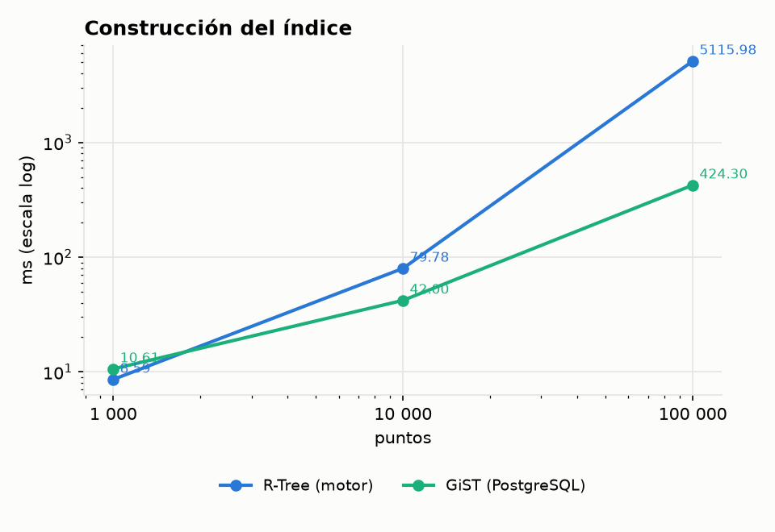
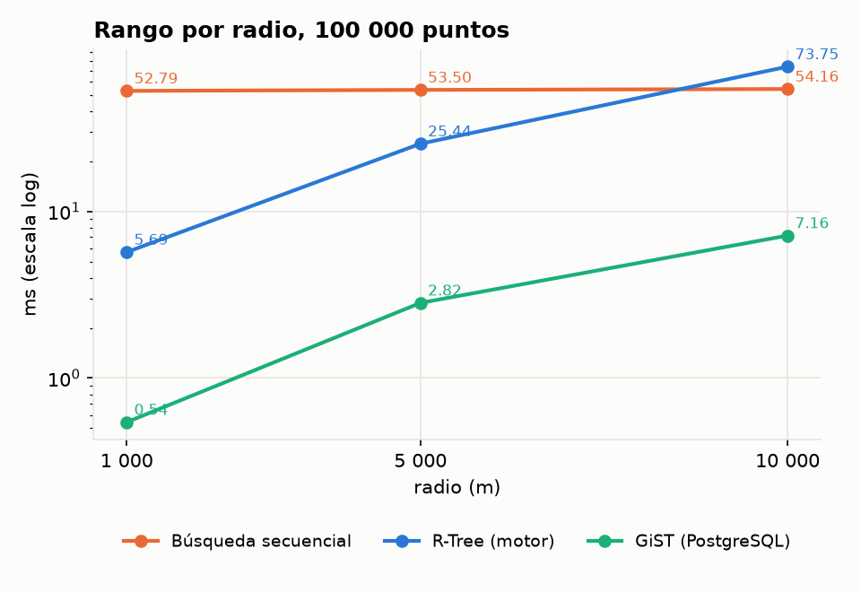
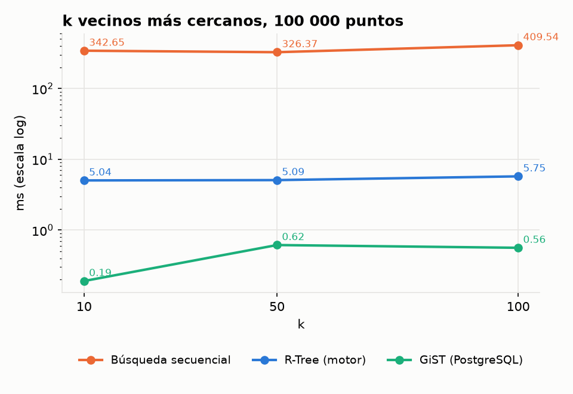
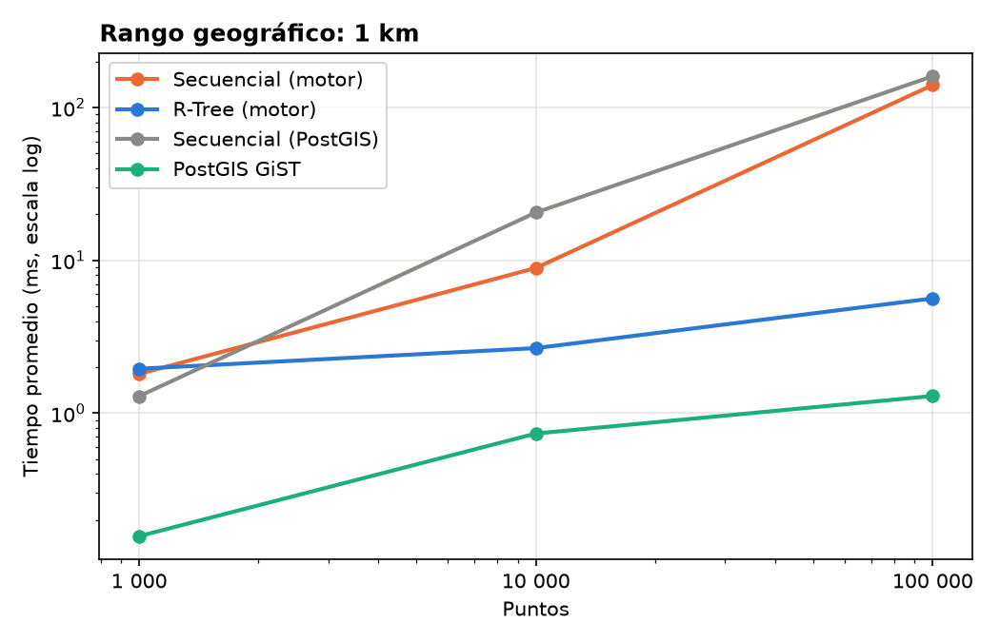
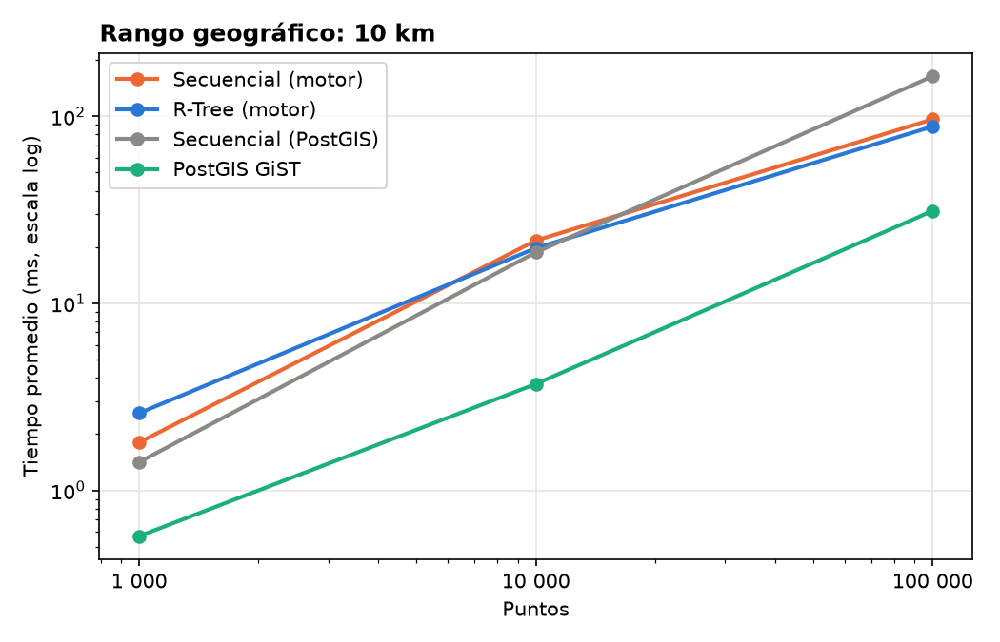
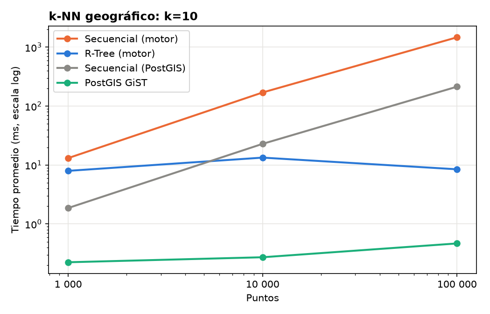

# Comparación espacial: búsqueda secuencial vs R-Tree vs GiST

Sección 2.2.4 del enunciado. Se compara la búsqueda secuencial y el R-Tree del motor con
el índice GiST de PostgreSQL sobre los mismos puntos.

```bash
make bench-espacial                          # secuencial y R-Tree, escribe datos/resultados/espacial_bench.csv
# GiST: abrir datos/resultados/gist_bench.sql en pgAdmin (Query Tool) y ejecutar
python3 docs/comparacion_espacial/graficar.py  # gráficas a partir de los dos CSV
```

## 1. Metodología

- **Datos:** 1 000, 10 000 y 100 000 puntos alrededor de Lima, generados con un congruencial
  de semilla 42. El mismo generador está escrito en C++ (`espacial_bench.cpp`) y en SQL
  (`gist_bench.sql`); las sumas de coordenadas coinciden en los dos lados, así que se miden
  exactamente los mismos puntos.
- **Consultas:** para cada caso, el promedio de 100 consultas con centros tomados de los
  mismos puntos:
  - rango con radios de 1, 5 y 10 km;
  - k-NN con k = 10, 50 y 100.
- **Métrica:** euclidiana en ambos lados, porque es la que calcula GiST con el tipo `point`
  nativo sin PostGIS (los metros se pasan a grados con 111 194,9 m por grado).
- **Motor:** la consulta pasa por todo el motor SQL (parseo, plan, apertura de archivos y
  lectura del heap). La tabla es `HEAP`; el R-Tree se crea con `CREATE INDEX ... USING RTREE`.
- **PostgreSQL 18:** el índice se crea con `CREATE INDEX ... USING gist (p)`. Los tiempos se
  miden dentro de un bloque PL/pgSQL, con la tabla ya en memoria compartida.
- **Validación:** el benchmark del motor verifica que el R-Tree devuelve las mismas filas
  que la búsqueda secuencial, y el promedio de filas de GiST coincide en los 18 casos.

Los tiempos del motor incluyen abrir los archivos y leer el catálogo en cada consulta,
mientras que los de PostgreSQL no. Por eso la comparación justa entre el R-Tree y GiST es
la forma en que crece cada uno, no el valor absoluto.

## 1.1 Comparación adicional con PostGIS

El benchmark GiST anterior usa `point` nativo y distancia euclidiana; **no es PostGIS**.
Para medir PostGIS con coordenadas geográficas y una métrica comparable a la predeterminada
del motor, se incluye `datos/resultados/postgis_bench.sql`:

```bash
make bench-espacial-haversine   # motor con haversine: datos/resultados/espacial_haversine_bench.csv
# PostGIS en Docker (imagen postgis/postgis); se midió con PostgreSQL 17.5 y PostGIS 3.5.2
docker exec -i postgis psql -U postgres -d bd2_bench -v ON_ERROR_STOP=1 < datos/resultados/postgis_bench.sql
docker exec -i postgis psql -U postgres -d bd2_bench -c "\copy (SELECT estructura, n, operacion, parametro, round(tiempo_ms, 4) AS tiempo_ms, round(filas, 2) AS filas, paginas, bytes FROM postgis_resultados ORDER BY n, operacion, parametro, estructura) TO STDOUT WITH (FORMAT csv, HEADER)" > datos/resultados/postgis_bench.csv
python docs/comparacion_espacial/graficar_postgis.py   # graficas/postgis_*.png
```

El SQL crea `geography(Point,4326)`, un índice `GiST`, y usa `ST_DWithin(..., false)` para
radios geodésicos y `<->` para k-NN. Ambas estrategias PostGIS (secuencial y GiST) se
comparan con los mismos puntos generados con semilla 42 que el R-Tree del motor; se miden
100 consultas por combinación de tamaño y parámetro. Antes de terminar, el script verifica
que los IDs devueltos por secuencial y GiST coincidan en cada consulta. La corrida completa
tarda unos 28 minutos, casi todo en esas verificaciones con 100 000 puntos.

El motor usa una esfera de 6 371 000 m y PostGIS una de 6 371 008,8 m, así que un punto que
cae justo en el borde del radio puede quedar de distinto lado. Por eso, con 100 000 puntos,
el promedio de filas difiere en la segunda decimal en 5 y 10 km; en los otros 16 casos
coincide exactamente.

El archivo adicional de almacenamiento `postgis_almacenamiento` registra por separado los
bytes del heap y del índice. `postgis_resultados.bytes` contiene el tamaño del índice en la
fila de construcción. Las mediciones de espacio son persistentes; no se reporta memoria
residente del servidor. El tiempo absoluto tampoco es una comparación directa de motores:
el motor y PostgreSQL/PostGIS tienen distinta caché, almacenamiento y sobrecarga de consulta.
Las figuras de GiST nativo se conservan aparte de las de PostGIS; los resultados están en la
sección [2.1](#21-postgis-con-distancia-haversine).

## 2. Resultados

### Construcción del índice

| n | R-Tree: tiempo | R-Tree: tamaño | GiST: tiempo | GiST: tamaño |
|---:|---:|---:|---:|---:|
| 1 000 | 8,6 ms | 40 KB | 10,6 ms | 72 KB |
| 10 000 | 79,8 ms | 356 KB | 42,0 ms | 680 KB |
| 100 000 | 5 116 ms | 3 448 KB | 424,3 ms | 6 528 KB |



El R-Tree ocupa la mitad que GiST porque guarda solo el MBR y la posición (24 B por
entrada). Su construcción es más lenta con 100 000 puntos porque inserta punto por punto y
lee cada fila del heap a través del motor; GiST lo construye de una sola vez sobre la tabla
ya cargada.

### Rango por radio (100 000 puntos)

| Radio | Filas | Secuencial | R-Tree | GiST |
|---:|---:|---:|---:|---:|
| 1 km | 126 | 52,8 ms | 5,7 ms | 0,54 ms |
| 5 km | 2 895 | 53,5 ms | 25,4 ms | 2,82 ms |
| 10 km | 10 370 | 54,2 ms | 73,7 ms | 7,16 ms |



La búsqueda secuencial cuesta lo mismo con cualquier radio: siempre lee las 491 páginas
del heap. El R-Tree gana con radios chicos (9 veces más rápido con 1 km), pero su costo
crece con el número de filas, porque por cada fila encontrada lee una página del heap. Con
10 km la consulta devuelve el 10 % de la tabla y el R-Tree termina siendo más lento que
recorrer el archivo, igual que pasa con el B+ no agrupado en rangos anchos. GiST sigue la
misma forma, pero unas 10 veces más rápido.

### k vecinos más cercanos (100 000 puntos)

| k | Secuencial | R-Tree | GiST |
|---:|---:|---:|---:|
| 10 | 342,6 ms | 5,0 ms | 0,19 ms |
| 50 | 326,4 ms | 5,1 ms | 0,62 ms |
| 100 | 409,5 ms | 5,7 ms | 0,56 ms |



Aquí está la mayor diferencia. La búsqueda secuencial calcula la distancia de los 100 000
puntos y ordena todo con el merge sort externo antes de cortar en k. El R-Tree baja solo
por los nodos más prometedores (unas 14 páginas entre nodos y heap para k = 10) y su tiempo
casi no depende de k: es entre 64 y 71 veces más rápido que el secuencial.

### 2.1 PostGIS con distancia haversine

Las mismas consultas, ahora en metros sobre la esfera: el motor con `distancia(..., 'haversine')`
y PostGIS con `geography`. Cada lado tiene su propio recorrido secuencial.

| n | R-Tree: tiempo | R-Tree: tamaño | PostGIS GiST: tiempo | PostGIS GiST: tamaño | Heap de PostGIS |
|---:|---:|---:|---:|---:|---:|
| 1 000 | 14,1 ms | 40 KB | 4,2 ms | 72 KB | 72 KB |
| 10 000 | 137,7 ms | 356 KB | 61,5 ms | 664 KB | 672 KB |
| 100 000 | 2 965 ms | 3 448 KB | 1 178 ms | 7 288 KB | 6 672 KB |

El GiST de `geography` ocupa más que la propia tabla y más del doble que el R-Tree, en parte
porque guarda cajas en tres dimensiones (coordenadas geocéntricas) en vez del MBR de latitud y
longitud. Sigue construyéndose unas 2,5 veces más rápido que el R-Tree.

Rango por radio, 100 000 puntos:

| Radio | Filas | Secuencial (motor) | R-Tree | Secuencial (PostGIS) | PostGIS GiST |
|---:|---:|---:|---:|---:|---:|
| 1 km | 129 | 140,3 ms | 5,6 ms | 160,1 ms | 1,29 ms |
| 5 km | 2 955 | 174,9 ms | 30,7 ms | 159,5 ms | 8,24 ms |
| 10 km | 10 575 | 96,4 ms | 88,3 ms | 163,7 ms | 31,2 ms |




La forma es la misma que con la métrica euclidiana. El secuencial de PostGIS cuesta unos
160 ms con cualquier radio; el del motor varía entre 96 y 175 ms por ruido de la laptop,
aunque siempre lee todas las páginas. Con 1 km el GiST es 124 veces más rápido que su
secuencial y el R-Tree 25 veces más rápido que el suyo; con 10 km la ventaja baja a 5 veces
en PostGIS y prácticamente desaparece en el motor, que lee una página del heap por cada
fila encontrada.

k vecinos más cercanos, 100 000 puntos:

| k | Secuencial (motor) | R-Tree | Secuencial (PostGIS) | PostGIS GiST |
|---:|---:|---:|---:|---:|
| 10 | 1 473,1 ms | 8,5 ms | 213,7 ms | 0,47 ms |
| 50 | 1 176,5 ms | 9,4 ms | 196,7 ms | 0,69 ms |
| 100 | 1 008,1 ms | 10,4 ms | 256,3 ms | 1,53 ms |



El secuencial del motor es el más lento porque ordena los 100 000 puntos con el merge sort
externo; PostgreSQL ordena con un top-k en memoria. Los dos índices casi no dependen de n:
el R-Tree tarda entre 8 y 13 ms con 1 000, 10 000 y 100 000 puntos, y el GiST entre 0,22 y
0,47 ms con k = 10. Frente a su propio secuencial, el GiST es entre 168 y 458 veces más
rápido y el R-Tree entre 97 y 174 veces.

Comparado con el GiST sobre `point` de la sección anterior, el de `geography` es más lento
(1,29 ms contra 0,54 ms en 1 km y 0,47 ms contra 0,19 ms en k-NN con k = 10), porque calcula
distancias sobre la esfera en vez de euclidianas en grados. Las dos mediciones se hicieron en
servidores distintos (PostgreSQL 18 instalado y PostgreSQL 17.5 en Docker), así que esa
diferencia es solo orientativa.

## 3. Cuándo usar cada técnica

| Técnica | Conviene | No conviene |
|---|---|---|
| Búsqueda secuencial | tablas chicas, o radios que devuelven una parte grande de la tabla | k-NN y radios chicos sobre tablas grandes |
| R-Tree del motor | k-NN y radios chicos o medianos; ocupa la mitad que GiST | radios que devuelven más del 5 al 10 % de la tabla; construcción por inserciones |
| GiST de PostgreSQL | lo mismo que el R-Tree, con construcción más rápida y un motor mucho más optimizado | sin PostGIS solo ofrece distancia euclidiana en grados |
| GiST de PostGIS (`geography`) | distancias reales en metros; el más rápido en rango y k-NN | el índice ocupa más que la tabla; hay que instalar la extensión |

Los resultados crudos están en `datos/resultados/espacial_bench.csv`,
`datos/resultados/gist_bench.csv`, `datos/resultados/espacial_haversine_bench.csv` y
`datos/resultados/postgis_bench.csv`.
