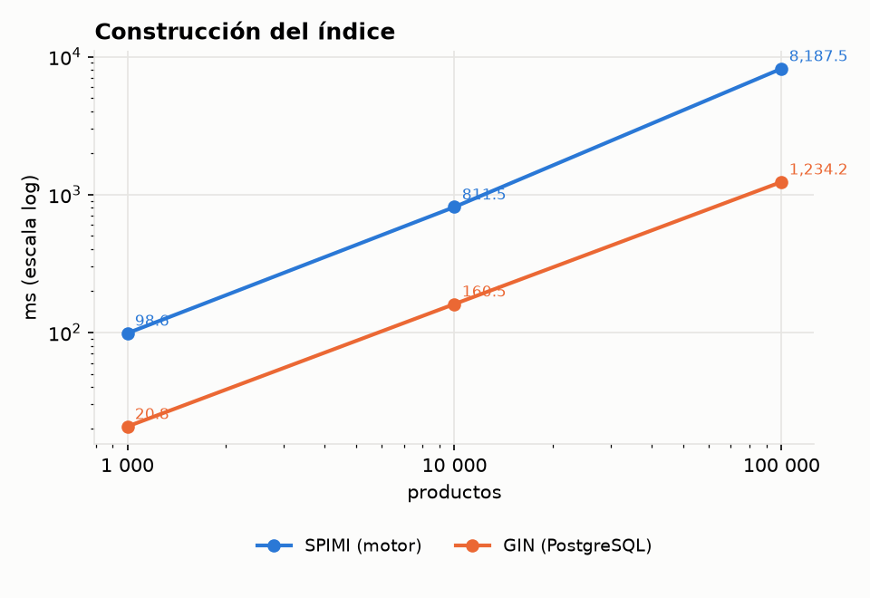
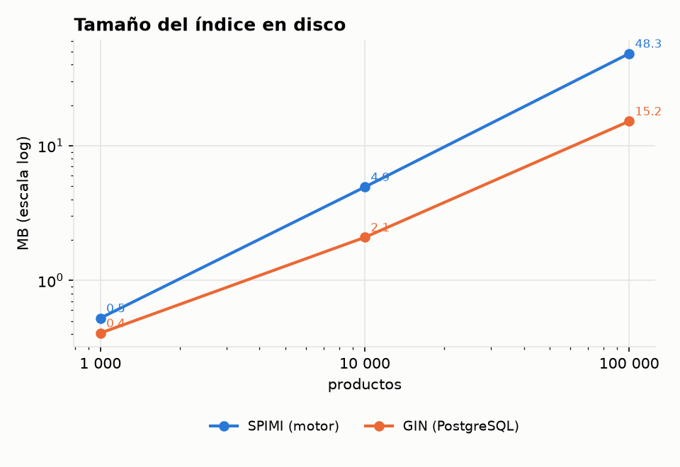
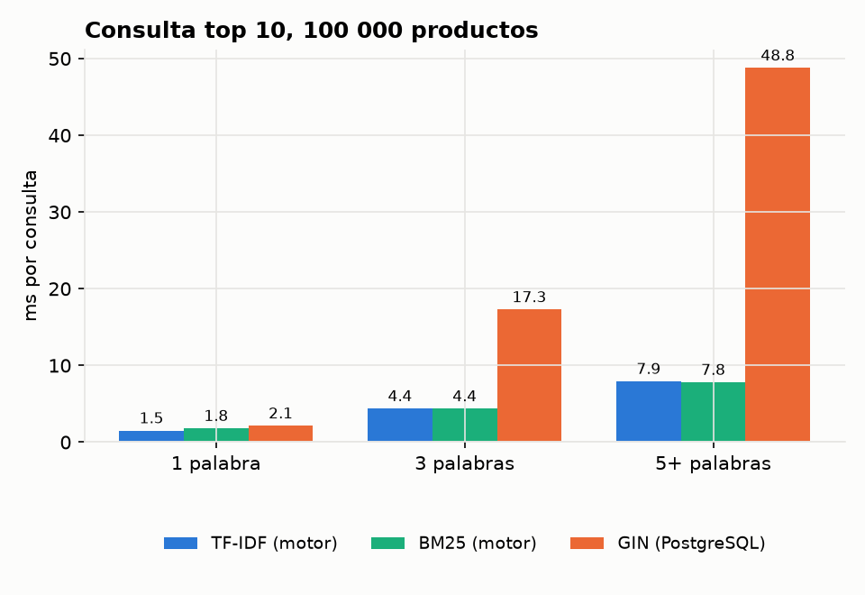
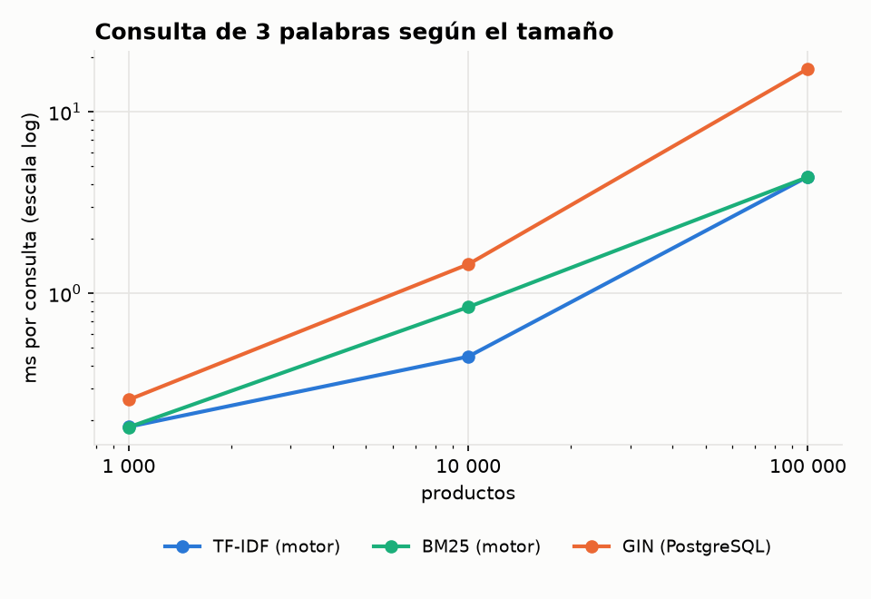
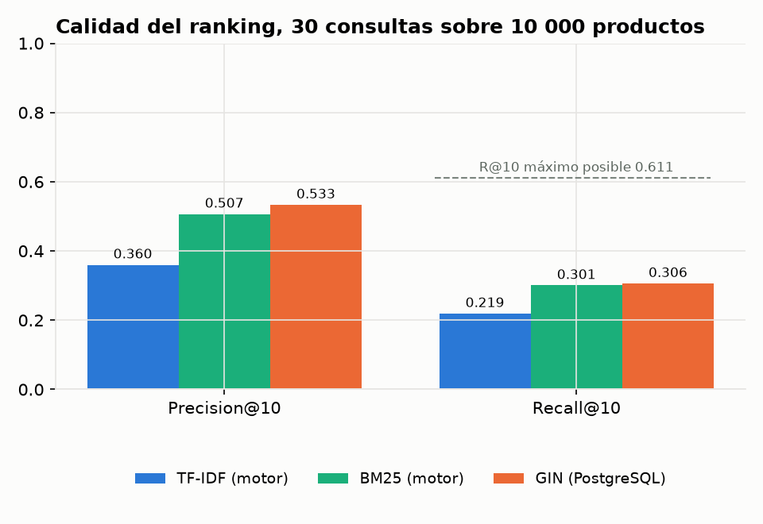

# Comparación de texto: TF-IDF vs BM25 vs GIN

Sección 2.3.2 del enunciado. Se compara el índice invertido SPIMI del motor, con ranking
TF-IDF (coseno) y BM25, contra el índice GIN de PostgreSQL con `ts_rank`, sobre la
descripción de los productos de ABO ([dataset.md](../dataset.md)).

```bash
make bench-texto      # SPIMI con TF-IDF y BM25 -> datos/resultados/texto_bench.csv y texto_ranking.csv
                      # y luego relevancia.py -> datos/resultados/texto_relevancia.csv
# GIN: ejecutar datos/resultados/gin_bench.sql en pgAdmin o psql (ver su encabezado) y exportar
#      gin_resultados -> datos/resultados/gin_bench.csv y gin_ranking -> datos/resultados/gin_ranking.csv
python docs/comparacion_texto/relevancia.py   # vuelve a evaluar con el ranking de GIN
python docs/comparacion_texto/graficar.py     # gráficas en docs/comparacion_texto/graficas/
```

En Windows con el `make` de Strawberry hay que indicar el compilador: `mingw32-make CXX=g++ bench-texto`.

## 1. Metodología

- **Datos:** `productos_1k.csv`, `productos_10k.csv` y `productos_100k.csv` (anidados). Se
  indexa la columna `descripcion`: nombre, viñetas y descripción del producto en inglés, hasta
  1 000 bytes.
- **Motor:** `motor/pruebas/texto_bench.cpp` construye el índice SPIMI (bloques de 4 MB, merge
  k-way), lo **reabre desde disco** y consulta con `buscar(indice, consulta, 10, ranking)`. Mide
  directamente el índice, sin la capa SQL.
- **PostgreSQL 18:** `datos/resultados/gin_bench.sql`, igual que el ejemplo de la semana 10:
  columna `tsvector GENERATED ALWAYS AS (to_tsvector('english', descripcion)) STORED`, índice
  `GIN`, `@@` y `ts_rank`, todo dentro de un bloque PL/pgSQL.
- **Consultas de tiempo:** 30 consultas fijas, 10 de cada largo (1, 3 y 5 o más palabras),
  escritas igual en los dos lados. Cada una se repite 5 veces y se reporta el promedio, después
  de una pasada de calentamiento que no se mide.
- **Semántica OR:** TF-IDF y BM25 rankean cualquier documento que tenga al menos una palabra
  de la consulta. Para que GIN responda lo mismo, la consulta de `plainto_tsquery` (que une con
  AND) se convierte a OR. Con AND, una consulta de 5 palabras casi nunca encuentra productos.
- **Relevancia:** 30 consultas escritas a mano ([consultas_relevancia.csv](consultas_relevancia.csv)),
  cada una con su juicio: un producto es relevante si tiene el mismo `tipo` y su `categoria`
  termina en la misma ruta (por ejemplo, "bar stool" → `STOOL_SEATING` en `.../Barstools`).
  Ninguno de los dos campos está en el texto indexado, así que el juicio no favorece a ninguna
  técnica. Se compara el final de la ruta porque cada marketplace de Amazon tiene su propio
  árbol. Las tres técnicas responden sobre los mismos 10 000 productos y se calcula
  Precision@10 y Recall@10 ([relevancia.py](relevancia.py)).

## 2. Construcción y espacio

| n | SPIMI: construcción | GIN: construcción | GIN: carga + `tsvector` | SPIMI: tamaño | GIN: tamaño |
|---:|---:|---:|---:|---:|---:|
| 1 000 | 99 ms | 21 ms | 68 ms | 0,5 MB | 0,4 MB |
| 10 000 | 0,81 s | 0,16 s | 0,73 s | 4,9 MB | 2,1 MB |
| 100 000 | 8,2 s | 1,23 s | 7,7 s | 48,3 MB | 15,2 MB |




- Los dos crecen de forma lineal con n (×10 documentos ≈ ×10 tiempo y espacio).
- **GIN construye casi 7 veces más rápido** (1,23 s contra 8,2 s con 100k), pero porque el `tsvector` ya está calculado: la
  tokenización y el stemming se pagan al cargar la tabla (7,7 s con 100k). Sumando carga e
  índice, PostgreSQL tarda casi lo mismo que SPIMI, que tokeniza dentro de la construcción.
- **GIN ocupa un tercio.** Sus listas de postings están comprimidas (diferencias entre ids con
  codificación de largo variable) y no guardan la frecuencia. SPIMI guarda cada posting sin
  comprimir: `doc_id` de 8 bytes y `tf` de 4 bytes.

## 3. Tiempo de consulta

| Consulta (100k productos) | TF-IDF | BM25 | GIN | Postings leídos por SPIMI |
|---|---:|---:|---:|---:|
| 1 palabra | 1,5 ms | 1,8 ms | 2,1 ms | 1 139 |
| 3 palabras | 4,4 ms | 4,4 ms | 17,3 ms | 15 723 |
| 5+ palabras | 7,9 ms | 7,8 ms | 48,8 ms | 38 138 |




- **TF-IDF y BM25 tardan lo mismo:** leen exactamente los mismos postings y solo cambia la
  fórmula del score. Las diferencias de ±0,3 ms entre corridas son ruido.
- El tiempo de SPIMI crece con los **postings leídos**: más palabras o más documentos dan
  listas más largas. Con 100k y 5 palabras recorre 38 mil postings (114 páginas de 4 KB).
- **GIN es parecido con 1 palabra, pero 4 a 6 veces más lento con varias.** El índice GIN
  solo dice *qué* filas cumplen `doc @@ q`; para rankearlas, PostgreSQL tiene que leer cada
  una de la tabla y calcular `ts_rank` sobre su `tsvector`. Con OR, son todas las filas que
  tengan alguna palabra (con "stainless steel insulated water bottle", miles). SPIMI calcula
  el score directamente desde los postings, que ya traen el `tf`, y se queda con los 10
  mejores en un heap sin tocar la tabla.

## 4. Calidad del ranking

| Técnica | Precision@10 | Recall@10 |
|---|---:|---:|
| TF-IDF (coseno) | 0,360 | 0,219 |
| BM25 | 0,507 | 0,301 |
| GIN (`ts_rank`) | **0,533** | **0,306** |

El Recall@10 máximo posible es 0,611: varias consultas tienen más de 10 productos relevantes
(por ejemplo, 84 sofás) y en 10 posiciones no caben todos.



- **BM25 supera a TF-IDF por 15 puntos de precisión.** El coseno de lnc.ltc favorece los
  documentos muy cortos: para "table lamp", TF-IDF pone primero "Rivet End Tables"
  (16 caracteres), que solo tiene "table"; como su vector tiene una norma chica, esa única
  palabra le da un coseno alto. BM25 satura la frecuencia (`k1 = 1,2`) y normaliza el largo de
  forma más suave (`b = 0,75`), así que prefiere las lámparas que tienen las dos palabras. Con
  "bar stool" pasa lo mismo: TF-IDF trae una manija de bar (36 caracteres) y BM25 acierta 9 de
  10.
- **GIN y BM25 quedan casi empatados.** `ts_rank` con la normalización por defecto no penaliza
  el largo del documento, igual que BM25 lo hace poco, y premia tener varias palabras de la
  consulta.
- Los juicios por metadatos son aproximados: un producto que sí responde la consulta pero está
  en otra categoría (por ejemplo, zapatillas de correr clasificadas en `/Categories/Men/Clothing`)
  cuenta como no relevante. Por eso los valores absolutos son bajos para las tres técnicas; lo
  que importa es la comparación entre ellas, que usa los mismos juicios.

## 5. Ventajas y desventajas

| | SPIMI + TF-IDF | SPIMI + BM25 | GIN de PostgreSQL |
|---|---|---|---|
| Construcción | lineal, con memoria acotada por bloque (4 MB) y merge k-way | igual | la más rápida del índice, pero el `tsvector` se calcula al cargar |
| Espacio | grande: postings sin comprimir con `tf` | igual | el más chico: postings comprimidos, sin `tf` |
| Consulta corta (1 palabra) | rápida | rápida | rápida |
| Consulta larga (OR, 3–5+ palabras) | rápida: score desde los postings + heap top-k | rápida | lenta: lee cada fila candidata para calcular `ts_rank` |
| Calidad del ranking | la más baja: el coseno premia los textos muy cortos | buena | buena, similar a BM25 |
| Actualización | `INSERT`/`DELETE` invalidan el índice y se reconstruye | igual | incremental (lista de pendientes `fastupdate`) |
| Cuándo conviene | colecciones de textos de largo parecido | ranking de propósito general; la mejor opción del motor | filtros booleanos (`@@` con AND) y tablas que cambian seguido |

**Conclusión:** para buscar y rankear texto en el motor, BM25 es la mejor opción: tiene la
misma velocidad que TF-IDF y una precisión mucho mayor, al nivel de PostgreSQL. Frente a GIN,
SPIMI ocupa unas 3 veces más espacio, pero responde las consultas de varias palabras entre 4 y
6 veces más rápido, porque el score sale del propio índice.

## 6. Limitaciones

- Los tiempos del motor miden el índice directamente (sin parser ni ejecutor SQL) y los de
  PostgreSQL se miden dentro de PL/pgSQL, con la tabla en memoria compartida. La comparación
  justa es cómo crece cada uno, no el valor absoluto.
- El stemming no es idéntico: el motor usa Porter y PostgreSQL el Snowball de `english`, y
  sus listas de stopwords son distintas.
- Una sola corrida en una laptop con Windows; con 5 repeticiones por consulta los tiempos bajo
  1 ms varían unos ±0,3 ms entre corridas.
