# Comparación vectorial: IVF vs HNSW vs k-NN secuencial, euclidiana vs coseno

Sección 2.4.4 del enunciado. Se compara el k-NN secuencial del motor C++ (`ORDER BY
distancia(v, VECTOR(...)) LIMIT 10`, [vectores.md](../vectores.md)) con los índices IVF y HNSW
de FAISS ([ivf.md](../ivf.md), `api/multimedia/indices.py`) y con el Flat exacto de FAISS, sobre
los vectores de las imágenes de los productos de ABO.

```powershell
# 1. vectores SIFT -> K-Means -> histograma TF-IDF de los 100k productos (~19 min con 7 procesos)
.\.venv\Scripts\python.exe api\multimedia\extraer.py --csv datos\productos_100k.csv `
  --imagenes C:\datos_bd2\imagenes --k 256 --procesos 7
# 2. benchmark (1k, 10k y 100k; ~2,5 min) y gráficas
mingw32-make CXX=g++ bench-vectorial
# 3. galería de éxitos y errores
.\.venv\Scripts\python.exe docs\comparacion_vectorial\galeria.py
```

`make bench-vectorial` corre `api/multimedia/bench_vectorial.py --motor`, que mide IVF y HNSW en
la misma pasada (un solo CSV, `datos/resultados/vectorial_bench.csv`, en vez de un archivo por
índice), y después `graficar.py`.

## 1. Metodología

- **Vectores:** histogramas TF-IDF de 256 palabras visuales (`VECTOR(256)`, `float32`, norma 1).
  El vocabulario se entrenó con 1 000 000 de descriptores SIFT tomados de las 100 000 imágenes.
  Se extrae una sola vez para 100k y se usan sus primeros 1k y 10k, que son los mismos
  productos de `productos_1k.csv` y `productos_10k.csv`.
- **Consultas:** 50 vectores de la colección con un ruido gaussiano pequeño (σ = 0,01), con
  semilla fija. Así se mide una búsqueda de vecinos y no solo que cada vector se encuentre a sí
  mismo. Las mismas consultas para todas las técnicas, con k = 10.
- **Ground truth:** el Flat de FAISS (`IndexFlatL2`, o `IndexFlatIP` sobre vectores normalizados
  para el coseno), que compara contra todos los vectores.
- **k-NN secuencial del motor:** con `--motor`, los vectores se cargan con `COPY` en una tabla
  `HEAP` (`id INT PRIMARY KEY, v VECTOR(256)`) y cada consulta es un `SELECT` con el nodo
  `Seq Vector Scan`. Se usa el tiempo que informa el motor, sin contar el arranque del proceso.
- **IVF:** `nlist ≈ √n` (25, 100 y 316 listas) y `nprobe` de 1 a `nlist`.
- **HNSW:** `M = 32`, `ef_construccion = 100` y `ef_busqueda` de 16 a 256.
- Un hilo de FAISS por consulta; una corrida en una laptop con Windows.

## 2. Tiempo de consulta

Con 100 000 vectores (en las gráficas contra n, IVF usa `nprobe = 8` y HNSW `ef_busqueda = 64`):

| Técnica | Coseno: ms | Coseno: Recall@10 | Euclidiana: ms | Euclidiana: Recall@10 |
|---|---:|---:|---:|---:|
| k-NN secuencial (motor) | 488 | 0,996 | 460 | 0,994 |
| Flat exacto (FAISS) | 3,72 | 1,000 | 4,41 | 1,000 |
| IVF, `nprobe = 8` | 0,58 | 0,934 | 0,60 | 0,952 |
| IVF, `nprobe = 32` | 3,07 | 0,986 | 2,03 | 1,000 |
| HNSW, `ef_busqueda = 64` | 0,42 | 0,978 | 0,39 | 0,886 |
| HNSW, `ef_busqueda = 256` | 1,16 | 0,984 | 1,74 | 0,944 |

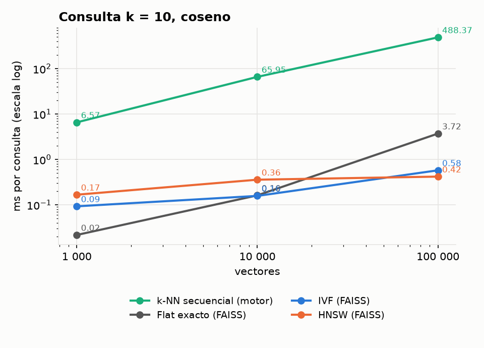
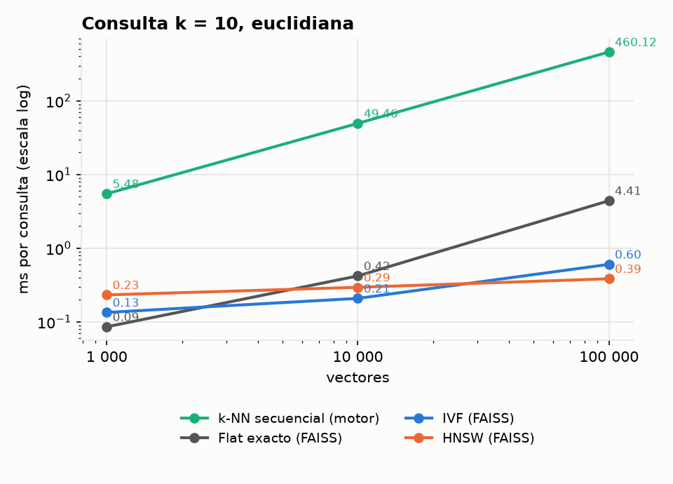

- **El k-NN secuencial crece lineal con n** (6,6 → 66 → 488 ms): lee las 33 334 páginas de la
  tabla (3 vectores de 1 KB por página) y calcula 100 000 distancias. El Flat de FAISS hace las
  mismas cuentas, pero en memoria y con instrucciones vectoriales (SIMD), y es 130 veces más
  rápido. La diferencia es el costo de leer del disco y deserializar cada registro.
- **IVF y HNSW casi no crecen**: de 1k a 100k, IVF pasa de 0,09 a 0,58 ms y HNSW de 0,17 a
  0,42 ms, porque solo revisan una parte de los vectores (IVF ≈ `nprobe · n / nlist`, HNSW unos
  cientos de nodos del grafo). Con 100k, HNSW es **1 000 veces más rápido** que el recorrido del
  motor y 9 veces más que el Flat.
- Con 1k vectores el Flat es el más rápido (0,02 ms): con tan pocos datos, recorrerlos todos
  cuesta menos que consultar la estructura del índice.

## 3. Recall contra tiempo

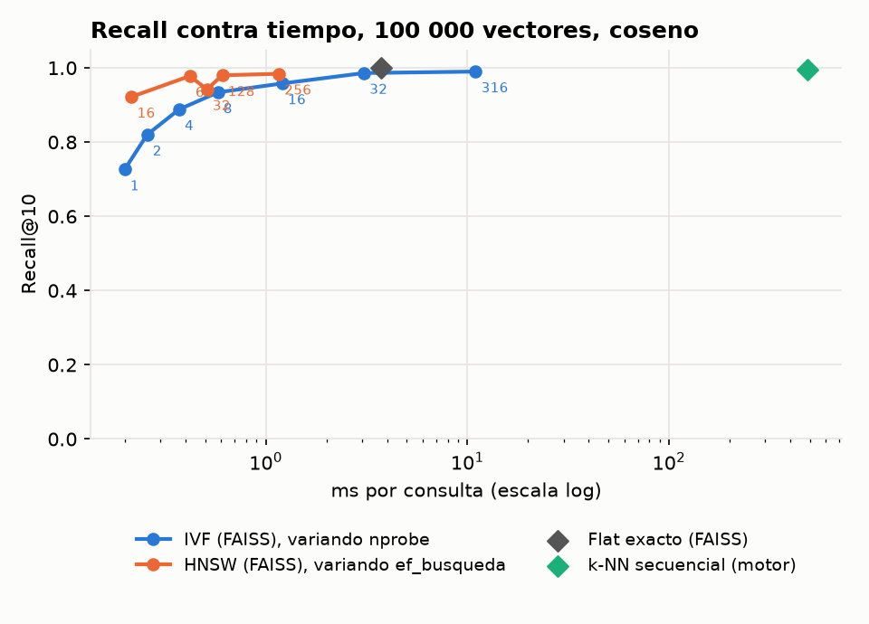
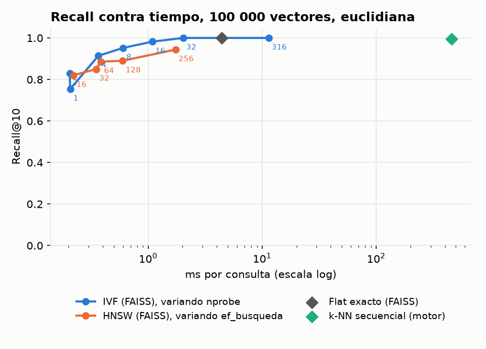

- **IVF** cambia recall por tiempo de forma predecible: cada vez que se duplica `nprobe` se
  revisan el doble de listas. Con coseno sube de 0,73 (`nprobe = 1`, 0,20 ms) a 0,93 (8, 0,58 ms)
  y 0,99 (32, 3 ms). Más allá ya cuesta lo mismo que el Flat.
- **HNSW** llega antes a un recall alto: con coseno y `ef_busqueda = 16` ya da 0,92 en 0,22 ms.
  Pero se estanca: subir `ef_busqueda` a 256 lo deja en 0,98 y multiplica el tiempo por 5.
- **Para el mismo tiempo, HNSW gana con coseno** (0,98 contra 0,93 de IVF en ~0,5 ms). Con
  euclidiana es al revés: HNSW se queda en 0,89–0,94 y IVF llega a 1,0 con `nprobe = 32`.

## 4. Euclidiana vs coseno

`extraer.py` entrega los histogramas con norma 1 y, con vectores normalizados,
‖a − b‖² = 2 − 2 cos(a, b): **las dos métricas ordenan los vecinos igual**. Por eso el Flat, el
motor e IVF dan casi el mismo recall con las dos. La diferencia aparece en HNSW (0,89 contra
0,98 con `ef_busqueda = 64`). El grafo se construye con la métrica del índice, y una explicación
probable (no la medimos aparte) es que con la euclidiana al cuadrado, en el rango muy chico de
distancias entre vectores de norma 1, quedan más vecinos casi empatados y la búsqueda voraz se
detiene antes.

**Recomendación:** coseno. Es la métrica pensada para histogramas, porque compara la proporción
de palabras visuales y no la cantidad. Además, rinde mejor con HNSW y sigue siendo correcta si
algún vector llega sin normalizar.

## 5. Construcción y espacio

| n | IVF: construcción | HNSW: construcción | Flat | IVF | HNSW |
|---:|---:|---:|---:|---:|---:|
| 1 000 | 10 ms | 98 ms | 1,0 MB | 1,0 MB | 1,2 MB |
| 10 000 | 0,12 s | 0,62 s | 9,8 MB | 9,9 MB | 12,4 MB |
| 100 000 | 1,8 s | 13,5 s | 97,7 MB | 98,7 MB | 124,4 MB |

(Coseno. El k-NN secuencial no construye nada: usa la tabla tal cual.)

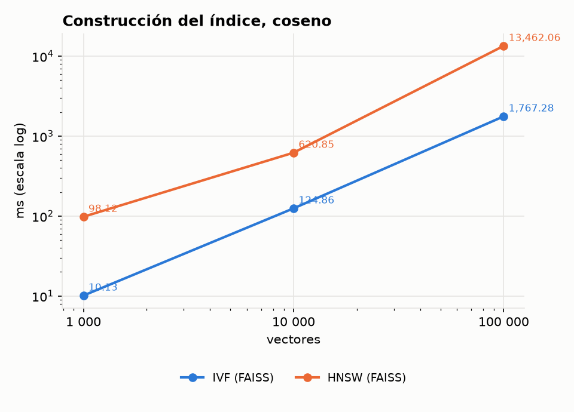
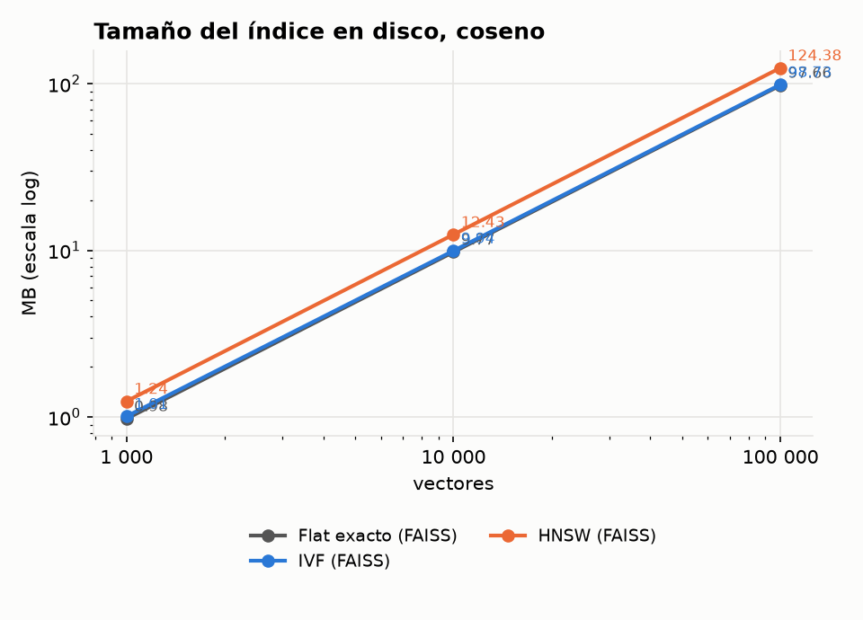

- **IVF construye 7 veces más rápido que HNSW**: su costo es entrenar el k-means (10
  iteraciones sobre una muestra) y asignar cada vector a una lista. HNSW inserta los vectores de
  a uno, buscando en el grafo los `M` vecinos de cada uno.
- **Ninguno ahorra espacio**: los dos guardan los vectores completos (`Flat`). IVF agrega solo
  los ids y los centroides (+1 %); HNSW agrega los enlaces del grafo, `M = 32` vecinos por nodo
  (+27 %).

## 6. Galería: 3 éxitos y 3 errores

Consulta y top 5 por coseno sobre los 100k productos ([galeria.py](galeria.py)). Borde verde:
mismo `tipo` que la consulta; rojo: otro tipo. Éxito: al menos 4 de los 5 vecinos son del mismo
tipo; error: ninguno.


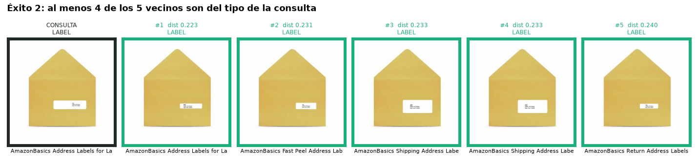
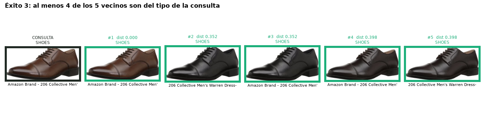
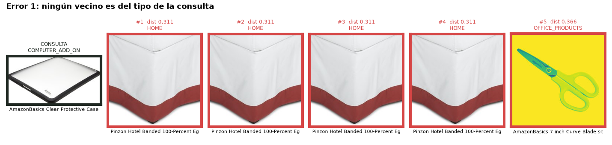
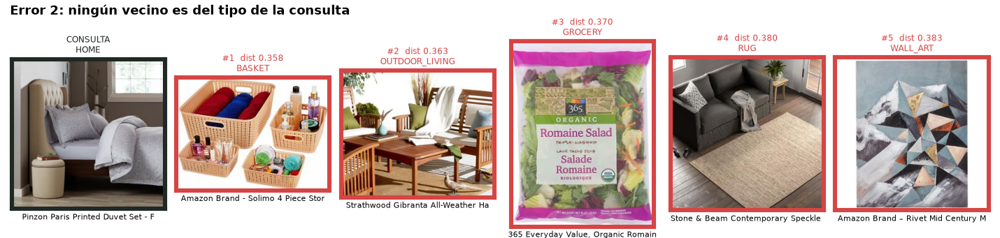
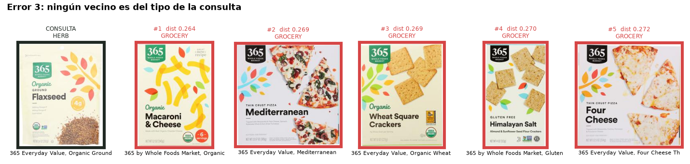

- **Éxitos:** imágenes con mucha textura y un diseño repetido. En el éxito 1, una funda con un
  guacamayo devuelve el mismo diseño para otros 5 modelos de celular: es el caso de "otra foto
  del mismo producto". Nuestro dataset guarda solo la imagen principal de cada producto
  (`main_image_id`), así que el criterio usa el `tipo` y no `other_image_id`.
- **Errores:** objetos lisos o blancos (una funda transparente que devuelve faldones de cama).
  SIFT encuentra pocos puntos clave en superficies sin textura, y la bolsa de palabras visuales
  no sabe de forma ni de color, así que se parecen por el fondo blanco.

`bench_vectorial.py --productos-csv ... --imagenes ...` también arma una galería HTML con los
vecinos de IVF y HNSW frente al exacto, para revisar consultas una por una.

## 7. Comparación y recomendaciones

| Técnica | Ventajas | Desventajas | Cuándo usarla |
|---|---|---|---|
| k-NN secuencial (motor) | exacto; no necesita índice ni memoria extra; funciona con `WHERE` y las tres organizaciones | lee toda la tabla del disco: ~0,5 s con 100k | tablas chicas, o como base exacta para medir recall |
| Flat (FAISS) | exacto y rápido mientras quepa en memoria; no se entrena | recorre todo: crece lineal con n | hasta ~10k vectores, y como ground truth |
| IVF | construcción rápida; `nprobe` ajusta recall y tiempo de forma predecible; casi no ocupa espacio extra | necesita entrenar; con `nprobe` chico pierde vecinos en los bordes de las celdas | colecciones grandes que cambian (reentrenar es barato) o cuando se quiere controlar el recall |
| HNSW | el mejor recall a igual tiempo con coseno; consulta casi constante | construcción 7 veces más lenta; +27 % de memoria; el recall se estanca y con euclidiana es más bajo | búsqueda interactiva sobre colecciones que caben en memoria, como `SIMILAR_TO` en la web |

**Recomendación para el proyecto:** HNSW con coseno y `ef_busqueda = 64` para `SIMILAR_TO`
(0,98 de recall en 0,4 ms con 100k), IVF con `nprobe = 16` como alternativa si se reconstruye
seguido, y el k-NN secuencial del motor cuando la consulta lleva otros filtros en el `WHERE`.

## 8. Limitaciones

- **Empates:** 15 571 de los 100k productos comparten la foto con otro producto, así que tienen
  vectores idénticos. Si dos vecinos empatan en el puesto 10, cada técnica desempata distinto y
  una búsqueda exacta puede no coincidir al 100 % con otra (pasa en 6 de las 50 consultas con
  100k). Por eso el motor da 0,994–0,996 y no 1, e IVF con `nprobe = nlist` da 0,99.
- Los tiempos del motor incluyen leer el disco y los de FAISS no: la comparación justa entre el
  motor y FAISS es cómo crece cada uno con n.
- Las consultas son vectores de la colección con ruido, no fotos nuevas. Con fotos de otra
  cámara o fondo, el recall de los índices no cambia (es contra el exacto), pero la calidad de
  los vecinos sí.

## Pruebas

Desde la raíz del proyecto:

```powershell
$env:PYTHONPATH = "$PWD\api"
.\.venv\Scripts\python.exe -m unittest `
  multimedia.test_indices multimedia.test_extraer multimedia.test_bench_vectorial -v
```

Las pruebas del benchmark cubren 1k y 10k vectores sintéticos; las pruebas de índices validan
FAISS IVF/HNSW frente al cálculo exacto y el guardado/carga. Con `--motor`, el k-NN secuencial
del motor coincide con el Flat de FAISS salvo los empates descritos arriba.
