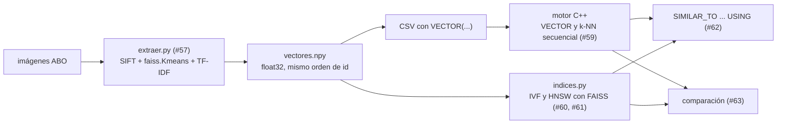

# Contratos de las Partes 3 y 4

Interfaces que se fijan antes de implementar la búsqueda de texto (sección 2.3) y la búsqueda
multimedia (sección 2.4), para que cada integrante trabaje en su rama sin esperar a los demás.
Es lo mismo que se hizo en la Parte 2 con `distancia.h` y `rtree.h`.

| Archivo | Qué define | Implementa |
|---|---|---|
| `motor/texto/preprocesamiento.h` | `tokenizar(texto)` | Jimena (#53) |
| `motor/texto/indice_invertido.h` | `IndiceInvertido` construido con SPIMI | Jimena (#53) |
| `motor/texto/ranking.h` | `buscar(indice, consulta, k, ranking)` con TF-IDF y BM25 | Noé (#54) |
| `motor/vectorial/vector.h` | `Vector`, `MetricaVec` y `distancia` | listo (#50) |
| `api/multimedia/indices.py` | `IndiceVectorial` para IVF y HNSW con FAISS | Dayane (#60), Luis (#61) |
| `motor/pruebas/texto_test.cpp` | pruebas de aceptación de texto | se agrega a `TESTS` en el PR de #53 |
| `motor/pruebas/vectorial_test.cpp` | pruebas de las tres métricas | ya está en `make test` |

Mientras un método no esté implementado lanza `no implementado` (`std::runtime_error` en C++,
`NotImplementedError` en Python), así que el proyecto compila y `make test` sigue en verde.

## 1. Texto

```cpp
namespace motor::texto {
std::vector<std::string> tokenizar(const std::string& texto);

struct Posting { long long doc_id; int tf; };

class IndiceInvertido {
public:
    IndiceInvertido(const std::string& directorio, std::size_t memoria_bloque = 4 MB);
    void agregar(long long doc_id, const std::string& texto);
    void construir();
    std::vector<Posting> postings(const std::string& termino);  // ordenados por doc_id
    int df(const std::string& termino);
    long num_docs() const;
    int largo_doc(long long doc_id);
    double largo_promedio() const;
    double norma_doc(long long doc_id);
    long paginas_leidas() const;
    long tamano_en_disco() const;
};

enum class Ranking { TF_IDF, BM25 };
struct Resultado { long long doc_id; double score; };
std::vector<Resultado> buscar(IndiceInvertido& indice, const std::string& consulta, int k,
                              Ranking ranking, double k1 = 1.2, double b = 0.75);
}
```

- `doc_id` es la posición del registro en la tabla, igual que `pos` en el R-Tree.
- `tokenizar` pasa a minúsculas, quita signos y stopwords en inglés (el texto del dataset ABO
  está en inglés) y aplica stemming de Porter. La prueba espera
  `"The CARS are running, fast!"` → `car run fast`.
- `memoria_bloque` es el límite de memoria de cada bloque de SPIMI. La prueba usa 256 bytes
  para que se escriban varios bloques y se tenga que hacer el merge.
- `norma_doc` es la norma del vector lnc del documento. Se calcula al construir; si no, el
  coseno tendría que recorrer todos los términos del documento en cada consulta.
- TF-IDF sigue el esquema lnc.ltc de la clase: el documento usa `1 + log10(tf)` y la consulta
  `(1 + log10(tf)) · log10(N / df)`, ambos normalizados. Con el ejemplo "seguro de carro" da 0,80.
- BM25 usa `idf = ln((N − df + 0,5) / (df + 0,5) + 1)`, `k1 = 1,2` y `b = 0,75`.
- `buscar` devuelve como mucho k resultados, de mayor a menor score, y solo documentos con score > 0.

## 2. Vectores

```cpp
namespace motor::vectorial {
using Vector = std::vector<float>;
enum class MetricaVec { EUCLIDIANA, PRODUCTO_PUNTO, COSENO };
MetricaVec metrica_vec_desde(const std::string& nombre);
double distancia(const Vector& a, const Vector& b, MetricaVec metrica);
void normalizar(Vector& a);
}
```

| Métrica | `distancia` | En SQL (`WITH METRIC=`) |
|---|---|---|
| Euclidiana | ‖a − b‖ | `euclidean` |
| Producto punto | −a · b | `inner_product` |
| Coseno | 1 − a · b / (‖a‖ ‖b‖) | `cosine` |

En las tres, **un valor menor es más parecido**, así que el k-NN siempre ordena de menor a
mayor. `VECTOR(K)` se guarda en `float32` (K = 256), igual que en FAISS.

## 3. Índices IVF y HNSW (FAISS)

El profesor aprobó usar los índices de FAISS en vez de implementarlos, con la condición de
explicar cómo funcionan por dentro y qué significa cada parámetro (eso va en `docs/ivf.md` y
`docs/hnsw.md`).

```python
IndiceVectorial(tipo, metrica, **parametros)
    construir(vectores, ids)    # numpy float32 (n, K) e ids = claves primarias de la tabla
    knn(consulta, k)            # [(id, distancia), ...] de menor a mayor distancia
    guardar(ruta) / cargar(ruta)
    tamano_en_disco()
```

| Tipo | Clase de FAISS | Parámetros (por defecto) |
|---|---|---|
| `IVF` | `IndexIVFFlat` | `nlist` = 100 listas, `nprobe` = 8 listas revisadas por consulta |
| `HNSW` | `IndexHNSWFlat` | `M` = 32 vecinos por nodo, `ef_construccion` = 40, `ef_busqueda` = 16 |

FAISS devuelve la euclidiana al cuadrado y, con producto interno, una similitud (mayor es
mejor). El adaptador las convierte a la convención de `vector.h`, para que el Recall@10
compare lo mismo que el motor. El coseno se hace con métrica de producto interno sobre
vectores normalizados con `faiss.normalize_L2`, que equivale a `normalizar` en C++.

## 4. Flujo



- Sin `USING`, la consulta `SIMILAR_TO` la resuelve el motor con un k-NN secuencial.
- Con `USING IVF` o `USING HNSW`, la API busca en el índice de FAISS y el motor devuelve las
  filas de esos id.
- El motor no enlaza FAISS: comparten `vectores.npy` y los mismos id.
