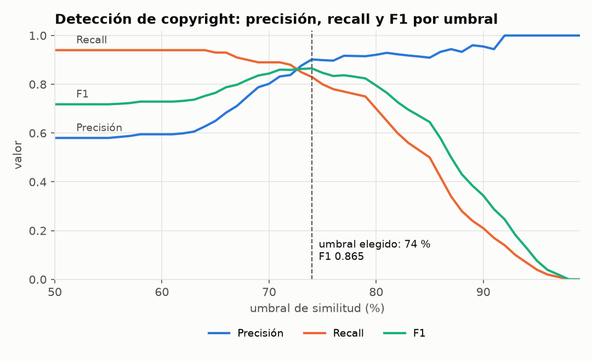

# Detección de copyright

La opción C del Anexo A detecta si una canción contiene fragmentos de otras. Para eso la base de originales no guarda un vector por canción, sino uno por cada tramo de la canción. Así un fragmento corto se compara con un tramo de su mismo tamaño y no con el clip entero.

La base son los 999 clips de 30 s de GTZAN (ver [extraccion_audio.md](extraccion_audio.md)).

## Cómo se parte

Cada clip se parte en tramos de 10 s, uno cada 5 s:

```
0-10, 5-15, 10-20, 15-25, 20-30   → 5 tramos por clip
```

Varios clips duran 29,98 s y no 30, así que el último tramo se acepta si le falta menos de medio segundo.

Cada tramo se convierte en vector con el código de `api/multimedia/segmentos_audio.py`:

1. `extraer_descriptores_audio(ruta, offset=inicio, duracion=10)` lee solo ese tramo y calcula sus MFCC: unas 431 ventanas de 13 coeficientes.
2. Se normaliza el tramo: a cada coeficiente se le resta su promedio y se divide por su desviación dentro del tramo.
3. Cada ventana se asigna a su palabra acústica más cercana del vocabulario `vocabulario_copyright_256.npy` y se arma el histograma.
4. Se aplica TF-IDF con `idf_copyright_256.npy` y norma L2. El resultado es un `VECTOR(256)`.

El vocabulario (K-Means de FAISS con hasta 1 000 000 de ventanas normalizadas) y el IDF se calculan con los propios tramos. No son los de `extraccion_audio.md`, así que `SIMILAR_TO('cancion.mp3')` no sirve sobre `segmentos`: un audio de consulta se analiza con `POST /api/copyright/analizar`, que lo procesa igual que los tramos.

## Por qué se normaliza cada tramo

Sin normalizar, el coeficiente 0 del MFCC mide la energía y es mucho más grande que los otros. Al bajar el volumen cambia en todas las ventanas, el K-Means las manda a otras palabras y el histograma sale distinto. Normalizar quita ese efecto, porque una constante sumada a un coeficiente desaparece al restar el promedio, y también reduce el efecto del ruido.

Se midió con 100 recortes de 15 s de canciones al azar, buscados entre los 4 995 tramos. La tabla dice en qué fracción de los tramos de consulta el tramo más parecido es de la canción correcta:

| Caso | Sin normalizar | Normalizado |
|---|---|---|
| Recorte limpio | 0,96 | 0,98 |
| Volumen −6 dB | 0,07 | 0,98 |
| Volumen +6 dB | 0,06 | 0,95 |
| Ruido blanco, SNR 20 dB | 0,13 | 0,78 |
| Velocidad +5 % | 0,99 | 0,97 |
| Velocidad −5 % | 0,76 | 0,94 |
| Mezcla de dos canciones | 0,08 | 0,41 |

Además separa mejor lo correcto de lo incorrecto: en el recorte limpio la mediana de similitud con la canción correcta es 0,91 y con la mejor otra 0,66 (sin normalizar, 0,97 y 0,81). Quitar solo el coeficiente 0 arreglaba el volumen pero no el ruido. La mezcla sigue siendo difícil, porque el histograma junta las palabras de las dos canciones.

## Por qué 10 s cada 5 s

- **10 s de largo:** dan unas 431 ventanas, suficientes para que el histograma sea estable. Con tramos de 5 s serían 216 ventanas y el histograma cambiaría más con poco ruido.
- **Cada 5 s (50 % de solapamiento):** cualquier fragmento de 10 s del original comparte al menos 7,5 s con algún tramo, y cualquier fragmento de 15 s contiene un tramo completo. Sin solapamiento (cada 10 s) un fragmento podría caer mitad en un tramo y mitad en otro.
- **Costo:** 5 tramos por clip en vez de 3, unos 5 000 vectores en total. Sigue siendo una base pequeña.

## Generar los tramos

```powershell
cd api
..\.venv\Scripts\python.exe -m multimedia.segmentos_audio --hop 5 --duracion 10
```

Lee `datos/audios_1k.csv` y los audios de `C:\datos_bd2\audio\genres_original` (se cambia con `--csv` y `--audios`). Reparte las canciones entre varios procesos y escribe en `datos/audio/`:

| Archivo | Columnas | Filas |
|---|---|---|
| `canciones.csv` | `id, archivo, genero` | 999 |
| `segmentos.csv` | `id, cancion_id, inicio, fin, v` | 4 995 |

`v` va en el formato `VECTOR(...)` que acepta `COPY`. `segmentos.csv` pesa 8,9 MB. También quedan `vocabulario_copyright_256.npy` (si ya existe, se reutiliza) e `idf_copyright_256.npy`. Con 8 procesos los 999 clips tardaron **30 s**, contando el K-Means. Cada proceso usa un solo hilo: con varios hilos cada uno se estorbaban y tardaba 704 s. La carpeta `datos/audio/` no se versiona.

## Cargar en el motor

`docs/copyright.sql` crea las tablas `canciones` y `segmentos`, las carga con `COPY` y crea dos índices:

- `segmentos_hnsw`, un HNSW sobre `segmentos(v)` para buscar los tramos más parecidos;
- `segmentos_cancion`, un B+ sobre `segmentos(cancion_id)` para traer los tramos de una canción.

Se puede pegar en la web o correr con `python tools/probar_sql.py docs/copyright.sql`.

## Control

Se tomaron 20 tramos al azar de la base (semilla 2026) y se buscó cada uno con `SIMILAR_TO(VECTOR(...), k = 5)`, con HNSW y sin índice:

| Medida | Resultado |
|---|---|
| El primero es el mismo tramo (similitud 1) | 20 de 20 |
| Recall@5 de HNSW contra la búsqueda sin índice | 1,000 |

Los otros vecinos suelen ser los tramos de al lado de la misma canción, porque se solapan 5 s con el buscado.

## Detección

`POST /api/copyright/analizar?nombre=cancion.mp3` recibe el audio crudo en el cuerpo (wav, mp3, flac u ogg, como `/api/multimedia/subir`) y lo analiza con `api/copyright.py`:

1. Parte la canción subida en tramos de 10 s cada 5 s, hasta 5 minutos, y saca el vector de cada tramo igual que en la base: MFCC normalizados, vocabulario e IDF de copyright.
2. Cada tramo con sonido busca sus 5 tramos más parecidos:

   ```sql
   SELECT id, cancion_id, inicio, fin, SIMILARITY_SCORE() AS similitud FROM segmentos
   WHERE SIMILAR_TO(VECTOR(...), k = 5) USING HNSW;
   ```

   `SIMILARITY_SCORE()` es la similitud del coseno y se muestra en porcentaje. Las consultas van en lotes a `/api/consultas`. Normalmente cabe todo en un lote, pero cada consulta ocupa unos 3 000 caracteres y la API acepta 64 000, así que una canción larga se manda en varios. El último lote trae el nombre y el género de `canciones`.
3. Un tramo coincide con una canción original si su similitud es mayor o igual al umbral (**74 %**). Una canción se reporta si coincide en al menos 2 tramos. Si el audio subido tiene un solo tramo, basta ese.
4. La respuesta trae la `duracion`, los `tramos` con sus coincidencias (canción, género, inicio y fin en el original, similitud y si supera el umbral), las `canciones` detectadas con cuántos tramos y qué porcentaje de la canción subida cubren, el `veredicto` (`posible_copyright` o `sin_coincidencias`), el `umbral` y las `consultas` SQL usadas.

Una canción de 3 minutos (35 tramos) se analiza en unos 3 s.

### Evaluación y umbral

```powershell
.venv\Scripts\python.exe tools\copyright\evaluar.py
python docs\copyright\graficar.py
```

`evaluar.py` carga `docs/copyright.sql` en una base temporal y arma 150 casos con semilla 2026. Tarda unos 30 s.

- **100 positivos** hechos con clips de GTZAN: 30 recortes de 10 a 20 s, y recortes de 15 s con volumen −6 dB (10), +6 dB (10), ruido blanco con SNR 20 dB (15), velocidad +5 % (10) y −5 % (10), más 15 mezclas de dos canciones.
- **50 negativos**: 20 audios sintéticos (notas al azar, ruido, barridos y acordes) y 30 recortes de 15 s de clips de GTZAN, sacando de los resultados los tramos de su propia canción.

Cada caso se analiza una vez y luego se mide con cada umbral de 50 a 99:

- **precisión:** de las canciones reportadas, cuántas eran de verdad la original;
- **recall:** de los 100 positivos, en cuántos se reporta la canción original (en las mezclas basta una de las dos);
- **F1:** el promedio armónico de las dos.

El resultado queda en `docs/copyright/evaluacion.csv` y en la gráfica `docs/copyright/evaluacion.png`.

| Umbral | Precisión | Recall | F1 | Negativos con alarma |
|---|---|---|---|---|
| 50 | 0,580 | 0,94 | 0,718 | 9 de 50 |
| 65 | 0,650 | 0,93 | 0,765 | 5 |
| 70 | 0,802 | 0,89 | 0,844 | 4 |
| 72 | 0,838 | 0,88 | 0,859 | 3 |
| **74** | **0,902** | **0,83** | **0,865** | **2** |
| 77 | 0,917 | 0,77 | 0,837 | 1 |
| 80 | 0,921 | 0,70 | 0,795 | 1 |
| 85 | 0,909 | 0,50 | 0,645 | 1 |
| 90 | 0,955 | 0,21 | 0,344 | 0 |



Se eligió **74 %** porque da el mayor F1. Por debajo aparecen muchas canciones equivocadas. Por encima se pierden copias reales, porque un recorte con ruido o con otra velocidad rara vez pasa del 85 %.

Con el umbral 74, por tipo de caso:

| Caso | Casos | Detectados |
|---|---|---|
| Recorte de 10 a 20 s | 30 | 30 |
| Volumen −6 dB | 10 | 10 |
| Volumen +6 dB | 10 | 10 |
| Ruido blanco, SNR 20 dB | 15 | 10 |
| Velocidad +5 % | 10 | 10 |
| Velocidad −5 % | 10 | 8 |
| Mezcla de dos canciones | 15 | 5 |
| Sintético (negativo) | 20 | 0 alarmas |
| Clip sin sus tramos (negativo) | 30 | 2 alarmas |

- **Lo más difícil es la mezcla:** el histograma junta las palabras de las dos canciones y ninguna de las dos se parece lo suficiente.
- **Las 2 alarmas:** son `pop.00030` contra `pop.00031` y `pop.00047` contra `pop.00080`, que llegan hasta 88 % y 91 %. Son clips de pop de GTZAN que suenan casi igual entre sí.
- **El orden no cuenta:** el histograma no mira el orden de las ventanas en el tiempo, así que un audio puesto al revés se sigue pareciendo a su original (75 a 84 % en una prueba aparte).

## Pruebas

```powershell
cd api
..\.venv\Scripts\python.exe -m unittest multimedia.test_segmentos test_copyright
```

`test_segmentos` usa audios sintéticos y revisa:
- cuántos tramos salen, con sus inicios y fines;
- la normalización;
- que un tramo da el mismo vector que ese recorte guardado como archivo aparte;
- que a la mitad del volumen el vector casi no cambia.

`test_copyright` revisa:
- la agrupación por tramos, con 2 tramos o 1 si el audio es corto;
- el umbral, el veredicto y el orden de las canciones;
- que los lotes no pasen el límite de la API.

Con el motor y una base de 3 canciones sintéticas revisa también que un recorte a la mitad del volumen encuentra su canción en los inicios correctos, que un audio distinto no reporta nada y que un archivo que no es audio da error 400. Las pruebas usan un umbral propio de 90 %, así que no dependen del umbral elegido.
