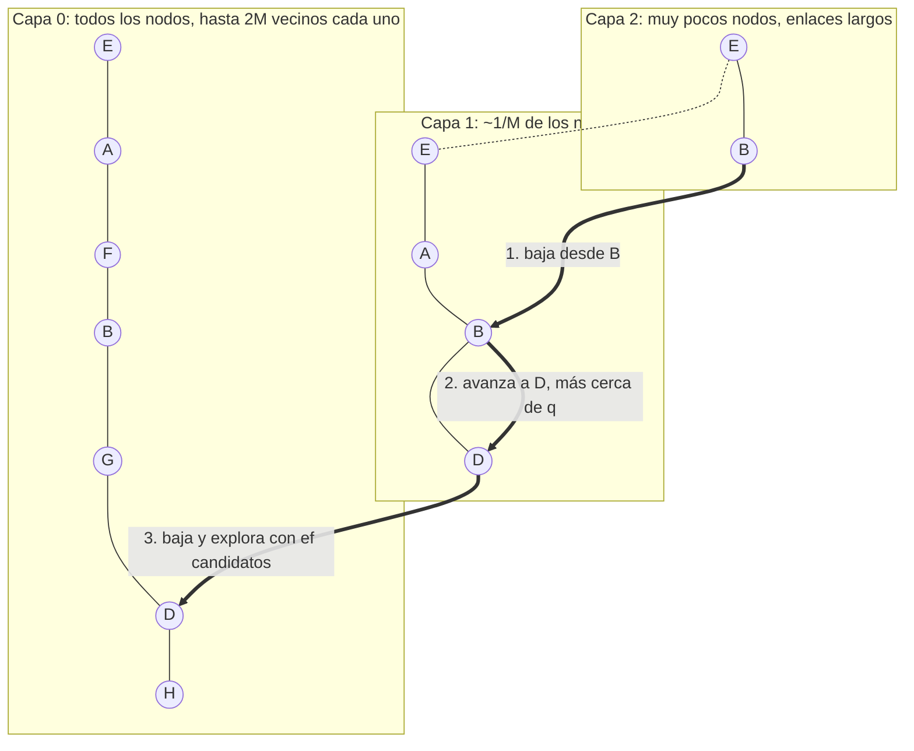

# Índice HNSW (Hierarchical Navigable Small World)

Índice para buscar los k vectores más parecidos (k-NN) recorriendo un grafo en vez de
comparar todos los vectores. Se usa en la Parte 4 para los histogramas de palabras visuales
de las imágenes (`VECTOR(256)`), junto con el IVF ([ivf.md](ivf.md)). No se ve en clase; este
documento resume el artículo de Malkov y Yashunin (2018) y cómo lo implementa FAISS.

El profesor aprobó usar el `IndexHNSWFlat` de FAISS en lugar de implementarlo (ver
[contratos_p3_p4.md](contratos_p3_p4.md)). El adaptador está en `api/multimedia/indices.py`:

```python
from multimedia.indices import IndiceVectorial
indice = IndiceVectorial("HNSW", "cosine", M=32, ef_construccion=100, ef_busqueda=64)
indice.construir(vectores, ids)    # numpy float32 (n, 256) e ids = PK de productos
indice.knn(consulta, 10)           # [(id, distancia), ...] de menor a mayor distancia
indice.insertar(nuevos, ids_nuevos)
indice.eliminar([15, 42])          # borrado lógico, ver abajo
indice.guardar("productos.hnsw")
```

## Idea

Un grafo de proximidad une cada vector con algunos de sus vecinos. Para buscar, se parte de
un nodo cualquiera y se salta siempre al vecino más cercano a la consulta, hasta que ninguno
mejora (búsqueda *greedy*). En un grafo plano eso es lento cuando n crece: desde un punto
lejano hacen falta muchos saltos cortos para llegar a la zona de la consulta.

HNSW resuelve eso con capas, como una *skip list*. La capa 0 tiene todos los vectores, y cada
capa de arriba tiene una fracción cada vez menor. Las capas altas tienen pocos nodos y
enlaces largos, que sirven para cruzar el espacio en pocos saltos; las bajas tienen enlaces
cortos, que sirven para afinar. La búsqueda empieza arriba y baja capa por capa.



La consulta entra por el punto de entrada `E` en la capa más alta, avanza mientras encuentra
un vecino más cercano, baja a la capa siguiente desde el nodo al que llegó y repite. En la
capa 0 deja de ser greedy y explora con una lista de `ef_busqueda` candidatos.
En el dibujo, la consulta q está cerca de D: entra por E en la capa 2, avanza a B, baja a
la capa 1, avanza a D y baja a la capa 0, donde busca los k vecinos alrededor de D.

## Construcción

Los vectores se insertan de a uno (algoritmo 1 del artículo):

1. **Nivel aleatorio.** Cada vector recibe un nivel `l = floor(-ln(U) · mL)`, con `U` uniforme
   en (0, 1) y `mL = 1 / ln(M)`. Así, la probabilidad de llegar a la capa 1 es 1/M, a la capa 2
   es 1/M², y así. Con `M = 32` y 100 000 vectores sintéticos, FAISS dejó 96 812 nodos solo en
   la capa 0, 3 093 hasta la capa 1, 92 hasta la 2 y 3 en la 3 (la más alta, ≈ log_M n).
2. **Bajada greedy.** Desde el punto de entrada se baja por las capas más altas que `l`
   saltando al vecino más cercano al vector nuevo.
3. **Conexión.** En cada capa desde `l` hasta 0 se buscan candidatos con una lista de
   `ef_construccion` elementos y se eligen hasta `M` vecinos (`2M` en la capa 0). La elección
   usa una heurística (algoritmo 4): un candidato entra solo si está más cerca del nodo nuevo
   que de los vecinos ya elegidos. Así los enlaces apuntan en direcciones distintas y el grafo
   no queda partido en grupos aislados.
4. **Enlaces de vuelta.** Los enlaces son de ida y vuelta. Si un vecino pasa del máximo, se
   recortan sus enlaces con la misma heurística.
5. Si `l` es mayor que el nivel máximo, el nodo nuevo pasa a ser el punto de entrada.

Insertar después de construir es exactamente esto mismo, por eso `insertar` no reconstruye.

## Búsqueda

1. Desde el punto de entrada, búsqueda greedy en cada capa alta (con un solo candidato).
2. En la capa 0, búsqueda en anchura acotada: una cola de prioridad de candidatos por
   explorar y una lista de los `ef` mejores vistos (`ef = max(ef_busqueda, k)`). Se toma el
   candidato más cercano, se calculan las distancias a sus vecinos no visitados y se agregan
   los que mejoran la lista. Termina cuando el candidato más cercano ya es peor que el peor de
   la lista.
3. Se devuelven los k mejores de la lista.

Vectores comparados por consulta: unos cientos, casi sin depender de n (ver Resultados).

**Por qué se pierde recall.** La búsqueda es local: si el camino greedy entra a una zona del
grafo y los vecinos verdaderos están en otra que no se alcanza con `ef` candidatos, no se
ven. Subir `ef_busqueda` explora más y recupera esos casos.

## Parámetros

| Parámetro | Por defecto | Qué controla | Si sube |
|---|---|---|---|
| `M` | 32 | vecinos por nodo en las capas altas (`2M` en la capa 0) | más recall y caminos más cortos, pero más memoria (`2M · 4` bytes por vector en la capa 0) y construcción más lenta |
| `ef_construccion` | 40 (el benchmark usa 100) | candidatos al buscar los vecinos de un nodo nuevo | mejores vecinos y mejor grafo, construcción más lenta; no cambia el tamaño. Se fija antes de insertar |
| `ef_busqueda` | 16 | candidatos en la capa 0 al consultar | más recall y más tiempo; se pasa en cada consulta (`SearchParametersHNSW`) |
| `umbral_reconstruccion` | 0,30 | fracción de posiciones borradas que dispara la reconstrucción (propio del adaptador) | menos reconstrucciones, más nodos muertos en el grafo |

Desde SQL: `CREATE INDEX idx ON t (v) USING HNSW WITH (M = 32, ef_busqueda = 64)` y
`SELECT ... WHERE SIMILAR_TO('foto.jpg', k=10) USING HNSW`. En SQL, `ef_busqueda` vale 64 por
omisión, lo que recomienda la [comparación](comparacion_vectorial/README.md); ver
[sql_multimedia.md](sql_multimedia.md).

## Métricas

Las mismas que el IVF y que `motor/vectorial/vector.h`: menor distancia es más parecido. El
HNSW usa `METRIC_L2` para la euclidiana (FAISS devuelve ‖a − b‖² y el adaptador saca la raíz)
y `METRIC_INNER_PRODUCT` para el producto punto (devuelve −a · b) y el coseno (sobre vectores
normalizados con `faiss.normalize_L2`, devuelve 1 − cos). La tabla completa está en
[ivf.md](ivf.md#métricas).

## Borrado

### Por qué HNSW no borra de verdad

FAISS no implementa `remove_ids` para `IndexHNSW`. Quitar un nodo deja a sus vecinos con
enlaces de menos, y los caminos que pasaban por él se cortan: una zona del grafo puede quedar
mal conectada o inalcanzable desde el punto de entrada. Repararlo exige volver a buscar los
vecinos de cada nodo afectado, casi lo mismo que reinsertarlos. Lo mismo pasa si el nodo
borrado es el punto de entrada.

### Borrado lógico por posición

El adaptador hace lo mismo que las tumbas del archivo secuencial
([sequential_file_paged.md](sequential_file_paged.md)): marca y no borra.

- FAISS numera los vectores del HNSW por orden de llegada: la **posición interna** 0, 1, 2…
  El adaptador guarda `pks[posicion]` (la PK de la tabla) y `borrados[posicion]`, más un
  diccionario `pk → posicion` de los vivos.
- `eliminar(ids)` busca la posición de cada pk viva y la marca como borrada.
- `knn` le pasa a FAISS un `IDSelectorNot(IDSelectorBatch(posiciones borradas))` dentro de
  `SearchParametersHNSW`. Los nodos borrados **se siguen recorriendo** (el grafo queda
  conectado a través de ellos) pero no entran al resultado.
- `insertar` siempre agrega una posición nueva. Si se borra la pk 15 y se vuelve a insertar
  con otro vector, la posición vieja queda marcada y la nueva es la única viva con la pk 15.

Se borra por posición y no por pk porque la pk se puede repetir en el tiempo. Con
`IndexIDMap2` (lo que había antes) el id que ve FAISS es la pk: al borrar la pk 15 y volver a
insertarla, el filtro tendría que excluir y aceptar el mismo id a la vez, y quedaría un vector
fantasma o se ocultaría el nuevo.

### Reconstrucción y umbral

Los nodos borrados siguen ocupando memoria y la búsqueda calcula su distancia. Cuando la
fracción de posiciones borradas pasa de `umbral_reconstruccion` (30 %, el mismo umbral que la
reorganización del archivo secuencial), `eliminar` reconstruye el grafo solo con los vectores
vivos (los recupera de FAISS con `reconstruct_batch`) y las posiciones quedan compactas
otra vez. El costo es el de construir de nuevo con los vivos, y se paga una vez cada vez que se
borra el 30 %.

## Almacenamiento

`guardar` escribe un solo archivo (formato `.npz` de NumPy) con tres arreglos:

- `indice`: el índice serializado con `faiss.serialize_index`. Trae los vectores completos
  (`float32`, porque es `Flat`), el nivel de cada nodo, la lista de vecinos de cada nodo en
  cada capa (`int32`), el punto de entrada y `efConstruction`.
- `pks`: la PK de cada posición (`int64`).
- `borrados`: la marca de cada posición (1 byte).

FAISS no conoce las pk ni los borrados; por eso van en el mismo archivo y se cargan juntos.
`cargar` toma `M` y `ef_construccion` del archivo y `ef_busqueda` del constructor. Igual que
el IVF, no usa páginas de 4 KB: el índice se carga entero en memoria.

Tamaño ≈ `n · (4 · K + 2M · 4)` bytes, más el nivel y un desplazamiento por nodo, los enlaces
de las capas altas (≈ n/M nodos) y 9 bytes por posición del adaptador (pk y marca).
Con 100 000 vectores de 256 dimensiones y `M = 32`: 130,5 MB, un 27 % más que los vectores
solos (102,4 MB); casi todo ese 27 % son los 64 vecinos de la capa 0 (256 bytes por vector).

## Resultados

`make bench-hnsw` (o `python api/multimedia/bench_hnsw.py`) escribe
`datos/resultados/hnsw_bench.csv`: 100 consultas con k = 10, métrica coseno, un hilo,
`M = 32` y `ef_construccion = 100`. Usa los mismos vectores sintéticos (dimensión 256,
alrededor de 100 centros) y las mismas consultas que `bench_ivf.py`. Con los vectores reales
de las imágenes, la comparación con IVF y el k-NN secuencial del motor está en
[comparacion_vectorial/README.md](comparacion_vectorial/README.md).

### Barrido de `ef_busqueda`

| n | Construcción | Fuerza bruta | `ef_busqueda` | HNSW | Recall@10 | Comparados |
|---:|---:|---:|---:|---:|---:|---:|
| 1 000 | 0,19 s | 1,7 ms | 10 | 0,150 ms | 1,00 | 196 |
| | | | 64 | 0,220 ms | 1,00 | 679 |
| 10 000 | 3,4 s | 13,3 ms | 10 | 0,150 ms | 0,99 | 235 |
| | | | 16 | 0,192 ms | 1,00 | 275 |
| | | | 64 | 0,338 ms | 1,00 | 483 |
| 100 000 | 43,2 s | 124,1 ms | 10 | 0,298 ms | 0,94 | 438 |
| | | | 16 | 0,419 ms | 0,96 | 550 |
| | | | 32 | 0,481 ms | 0,99 | 757 |
| | | | 64 | 0,525 ms | 1,00 | 949 |
| | | | 256 | 1,050 ms | 1,00 | 1 190 |

- **La consulta casi no depende de n.** De 1k a 100k la fuerza bruta crece 73 veces y el HNSW
  con `ef_busqueda = 64` solo 2,4 veces. Los vectores comparados pasan de 679 a 949 mientras n
  crece 100 veces: es el comportamiento logarítmico que promete el artículo.
- **`ef_busqueda` cambia recall por tiempo**, igual que `nprobe` en el IVF. Con 100k hacen
  falta 32 candidatos para llegar a 0,99; con 1k basta con 10.
- **La construcción es el costo.** Con un hilo, 100k vectores toman 43 s, contra ~1 s del IVF:
  cada inserción es una búsqueda en el grafo con `ef_construccion` candidatos. La comparación
  vectorial no limita los hilos y FAISS inserta en paralelo: ahí 100k toman 13,5 s.
- Con estos datos sintéticos, en grupos bien separados, el IVF con `nprobe = 4` llega a 0,99
  en 0,13 ms ([ivf.md](ivf.md#resultados)). Con los vectores reales de las imágenes, el HNSW da
  mejor recall a igual tiempo con coseno (ver la comparación vectorial).

### Borrado lógico, con y sin reconstruir

Con n = 10 000 y `ef_busqueda = 64`, se borran pk al azar hasta llegar a cada fracción. El
recall se mide contra la fuerza bruta sobre los vectores vivos.

| Borrado | Sin reconstruir: recall | comparados | tamaño | Con umbral 30 %: recall | comparados | tamaño | `eliminar` |
|---:|---:|---:|---:|---:|---:|---:|---:|
| 0 % | 1,00 | 483 | 13,0 MB | 1,00 | 483 | 13,0 MB | — |
| 30 % | 1,00 | 483 | 13,0 MB | 1,00 | 483 | 13,0 MB | 1,4 ms |
| 50 % | 1,00 | 483 | 13,0 MB | 1,00 | 668 | 6,5 MB | 1,36 s (reconstruye) |
| 70 % | 1,00 | 483 | 13,0 MB | 1,00 | 808 | 3,9 MB | 0,76 s (reconstruye) |
| 90 % | 0,96 | 483 | 13,0 MB | 1,00 | 679 | 1,3 MB | 0,15 s (reconstruye) |

- **Sin reconstruir, el borrado no ahorra nada.** Se calculan las mismas 483 distancias por
  consulta y el archivo pesa lo mismo, haya 0 % o 90 % borrado: el grafo se recorre igual y
  los nodos muertos solo se saltan al armar el resultado.
- **Con muchos borrados el recall cae** (0,96 con 90 %): los nodos muertos ocupan lugares de
  la lista de `ef` candidatos y quedan menos vivos entre los explorados.
- **Con el umbral, el índice vuelve a su tamaño real** y el recall se mantiene. Marcar es
  barato (1,4 ms por 1 000 pk); la reconstrucción cuesta lo que construir con los vivos y se
  paga una vez por cada 30 % borrado.

## Fuentes

- Y. A. Malkov y D. A. Yashunin (2018). *Efficient and robust approximate nearest neighbor
  search using Hierarchical Navigable Small World graphs*. arXiv:1603.09320; publicado en
  IEEE TPAMI 42(4), 824-836 (2020).
  Algoritmos 1 (inserción), 2 (búsqueda en una capa), 4 (heurística de vecinos) y 5 (k-NN);
  sección 4.1 sobre la elección de `mL = 1 / ln(M)`.
- W. Pugh (1990). *Skip lists: a probabilistic alternative to balanced trees*. CACM 33(6).
  La idea de los niveles aleatorios.
- Wiki de FAISS: *Guidelines to choose an index* e *Indexing 1M vectors*
  (<https://github.com/facebookresearch/faiss/wiki>), y el código de `IndexHNSW` y
  `impl/HNSW.cpp` (`set_default_probas`, `search` con `IDSelector`; `remove_ids` no está
  implementado para este índice).
