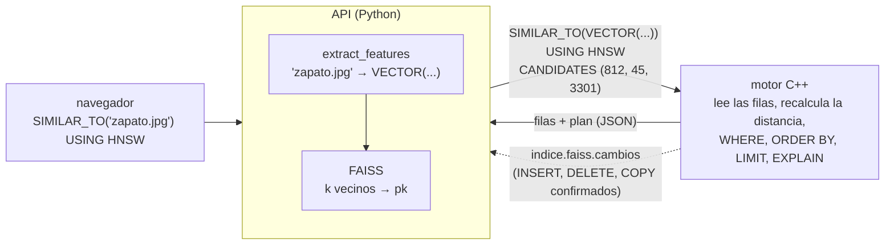

# SQL multimedia: SIMILAR_TO, SIMILARITY_SCORE y los índices IVF y HNSW

Búsqueda por similitud de la Parte 4 (#62). El motor C++ guarda la columna `VECTOR`, resuelve
el k-NN secuencial y arma la respuesta. Los índices IVF y HNSW son los de FAISS, que vive en la
API (Python), en otro proceso. Este documento explica cómo se reparten el trabajo y por qué.

## 1. Sintaxis

```sql
CREATE INDEX nombre ON t (col) USING IVF | HNSW [WITH (parametro = valor, ...)]

SELECT ..., SIMILARITY_SCORE() [AS alias] FROM t
  WHERE SIMILAR_TO([col,] 'archivo' | VECTOR(x1, ..., xk) [, k = n]) [AND cond]...
  [USING IVF | HNSW] [WITH METRIC = euclidiana | producto_punto | coseno]
  [GROUP BY ...] [ORDER BY ...] [LIMIT n]
```

- `k` vale 10 por omisión y la métrica, **coseno**: es la que recomienda
  [comparacion_vectorial](comparacion_vectorial/README.md) para histogramas de palabras visuales.
  También se aceptan los nombres en inglés (`cosine`, `euclidean`, `l2`, `inner_product`, `ip`).
- Sin columna, se usa la única columna `VECTOR` de la tabla; si hay varias, hay que nombrarla.
- `SIMILARITY_SCORE()` se llama `score` si no tiene alias, así que `ORDER BY score DESC` funciona.
- `SIMILAR_TO` primero elige los k vecinos. Después se aplican `ORDER BY`, `GROUP BY` y `LIMIT`
  sobre esos k. Sin `ORDER BY`, las filas salen de la más parecida a la menos parecida.
- No se admite más de un `SIMILAR_TO` por consulta, ni combinarlo con `MATCH`, ni usarlo en `DELETE`.

Ejemplos:

```sql
-- los 10 productos más parecidos a la foto, con el HNSW
SELECT id, titulo, SIMILARITY_SCORE() FROM productos
WHERE SIMILAR_TO('zapato.jpg', k=10) USING HNSW WITH METRIC=cosine ORDER BY score DESC;

-- sin índice: k-NN secuencial del motor, con el vector escrito a mano
SELECT id FROM productos WHERE SIMILAR_TO(v, VECTOR(0.12, 0, ...), k=5) WITH METRIC=euclidiana;

-- índices con sus parámetros
CREATE INDEX productos_hnsw ON productos (v) USING HNSW WITH (M = 32, ef_busqueda = 64);
CREATE INDEX productos_ivf ON productos (v) USING IVF WITH (nlist = 316, nprobe = 8, metrica = coseno);
```

## 2. Quién hace qué



| Consulta | Quién busca | Nodo de EXPLAIN |
|---|---|---|
| `SIMILAR_TO(...)` sin `USING` ni otras condiciones | el motor: una pasada por la tabla con un heap de k filas | `Seq Vector Scan (coseno)` |
| `SIMILAR_TO(...) AND cond` sin `USING` | el motor: el `WHERE` elige su vía, y de las filas que pasan se quedan las k más cercanas | la vía del `WHERE` + `Top-k` |
| `SIMILAR_TO(...) USING IVF \| HNSW` | FAISS en la API; el motor lee los candidatos por clave | `Vector Scan using idx (HNSW, coseno, ef=64)` |

### Por qué `CANDIDATES`

FAISS solo devuelve **pk y distancias**, no las filas: el título, el precio o la imagen están en
el motor. Alguien tiene que pedir esas filas y armar la respuesta con las columnas del `SELECT`,
`ORDER BY`, `LIMIT` y el plan. Ese trabajo ya lo hace el motor para cualquier consulta, así que la
API no lo repite en Python: le dice al motor qué filas eligió FAISS.

Si el usuario escribe

```sql
SELECT id, titulo, SIMILARITY_SCORE() FROM productos WHERE SIMILAR_TO('zapato.jpg', k=3) USING HNSW
```

la API saca el vector de `zapato.jpg`, busca en FAISS (que responde 812, 45 y 3301) y le manda al motor

```sql
SELECT id, titulo, SIMILARITY_SCORE() FROM productos
WHERE SIMILAR_TO(VECTOR(0.01, ...), k=3) USING HNSW CANDIDATES (812, 45, 3301)
```

El motor lee esas 3 filas, recalcula la distancia exacta, las ordena y responde como en
cualquier `SELECT`. El usuario nunca escribe `CANDIDATES`; lo agrega la API
(`api/multimedia/similitud.py`, función `reescribir`).

- En un heap sin índice sobre la clave, el motor lee los k candidatos en **una sola pasada**
  por la tabla. Con un B+ o un hash sobre la clave, o en las organizaciones secuencial y B+
  agrupado, los busca uno por uno.
- Un candidato que ya no existe (borrado después de la búsqueda) se salta.
- Un `EXPLAIN` sin `ANALYZE` no ejecuta: la API no busca y el motor muestra el plan sin
  candidatos. `EXPLAIN ANALYZE` sí busca.
- Lo que la API no puede resolver (tabla, columna o índice inexistente, o una métrica distinta
  de la del índice) se manda igual al motor, que responde con su propio error.
- La API busca en FAISS justo antes de mandar la consulta. Si el lote trae sentencias antes
  (`INSERT ...; SELECT ... USING HNSW`, o `CREATE TABLE`, `CREATE INDEX` y la búsqueda), lo parte
  ahí (`partir_lote`): primero corre y sincroniza lo anterior, y después busca. Así la búsqueda
  ve esos cambios y no recibe candidatos que una sentencia anterior ya borró. Dentro de una
  transacción no se parte, porque el motor deshace la transacción abierta al terminar cada lote.

## 3. SIMILARITY_SCORE()

Las tres métricas siguen la convención de [vectores.md](vectores.md): menor distancia = más
parecido. El score es al revés, para que `ORDER BY score DESC` dé primero lo más parecido:

| Métrica | Distancia d | SIMILARITY_SCORE() | Rango del score |
|---|---|---|---|
| coseno | 1 − cos(a, b) | 1 − d = cos(a, b) | [−1, 1]; 1 = misma dirección |
| producto punto | −(a · b) | −d = a · b | sin límite |
| euclidiana | ‖a − b‖ | 1 / (1 + d) | (0, 1]; 1 = iguales |

El score se calcula en el motor con la distancia exacta, también cuando buscó FAISS. Por eso,
con o sin índice, la misma fila tiene el mismo score.

## 4. EXPLAIN

Salida real del motor (3 filas, `VECTOR(3)`):

```text
EXPLAIN ANALYZE SELECT id, SIMILARITY_SCORE() FROM img WHERE SIMILAR_TO(VECTOR(1,0.2,0), k=2);

Projection on img (actual rows=2)
Output: id, score
  -> Seq Vector Scan on img (coseno)  (cost=1.00 rows=2) (actual time=0.058 rows=2 pages=1)
     Order By: SIMILAR_TO(v, VECTOR(3 dimensiones), k=2) [coseno]

EXPLAIN ANALYZE SELECT id, nombre, SIMILARITY_SCORE() FROM img
WHERE SIMILAR_TO(VECTOR(1,0.2,0), k=2) USING HNSW;      -- la API agrega CANDIDATES

Projection on img (actual rows=2)
Output: id, nombre, score
  -> Vector Scan using img_hnsw on img (HNSW, coseno, ef=64)  (cost=1.00 rows=2) (actual time=0.019 rows=2 pages=1)
     Order By: SIMILAR_TO(v, VECTOR(3 dimensiones), k=2) [coseno]

EXPLAIN SELECT * FROM img WHERE nombre != 'x' AND SIMILAR_TO(VECTOR(1,0.2,0), k=2);

Top-k on img  (cost=1.00 rows=1)
Order By: SIMILAR_TO(v, VECTOR(3 dimensiones), k=2) [coseno]
  -> Filter on img  (cost=1.00 rows=1)
     Filter: nombre != 'x'
    -> Seq Scan on img  (cost=1.00 rows=3)
```

- Con IVF el paréntesis dice `(IVF, coseno, nprobe=8)`.
- El costo de `Vector Scan` son las páginas del motor: k, o la tabla entera si es un heap sin
  índice sobre la clave. **El tiempo de FAISS no está en `Execution Time`**: la búsqueda pasa
  en la API, antes de llamar al motor. La API lo devuelve aparte, en el campo `faiss` de
  `/api/consultas` (`{"indice", "k", "candidatos", "vectores", "ms", ...}`).

## 5. CREATE INDEX ... USING IVF | HNSW

El motor valida la columna (tiene que ser `VECTOR`) y los parámetros, y anota el índice en su
catálogo **sin construirlo**. Lo construye la API con FAISS. El catálogo del motor sigue siendo
la única fuente de verdad: `DESCRIBE` muestra el índice, `--catalogo` lo entrega a la API y
`DROP TABLE` borra sus archivos, igual que con los demás índices.

```text
IDX|productos_hnsw|v|HNSW|datos/db/productos__productos_hnsw.faiss|metrica=COSENO,M=32,ef_construccion=40,ef_busqueda=64,umbral_reconstruccion=0.3
```

| Índice | Parámetro | Por omisión | Qué hace (detalle en [ivf.md](ivf.md) y [hnsw.md](hnsw.md)) |
|---|---|---|---|
| ambos | `metrica` | `coseno` | la del índice; la consulta tiene que pedir la misma |
| IVF | `nlist` | 100 | listas (centroides del k-means) |
| IVF | `nprobe` | 8 | listas que se revisan por consulta |
| HNSW | `M` | 32 | vecinos por nodo |
| HNSW | `ef_construccion` | 40 | candidatos al conectar un nodo nuevo |
| HNSW | `ef_busqueda` | 64 | candidatos en la búsqueda; 64 es lo que recomienda la comparación (el adaptador usa 16 si se crea a mano) |
| HNSW | `umbral_reconstruccion` | 0,3 | fracción de borrados lógicos que dispara la reconstrucción |

- Una columna puede tener un IVF y un HNSW a la vez, para compararlos.
- El IVF necesita al menos `nlist` filas para entrenar el k-means: sobre una tabla con menos
  filas, `CREATE INDEX` falla. El HNSW se puede crear sobre una tabla vacía.
- `DESCRIBE` muestra todos los índices de la columna: `productos_hnsw (HNSW), productos_ivf (IVF)`.
- Las consultas comunes (`=`, rangos, `ORDER BY`) nunca usan estos índices, y el motor no los
  abre al insertar ni al borrar.

## 6. Mantenimiento: el archivo de cambios

El motor no puede llamar a FAISS, pero sí sabe qué filas entran y salen. Por cada índice IVF o
HNSW escribe un archivo `<indice>.faiss.cambios`:

- `CREATE INDEX` vuelca la tabla entera (así la API construye el índice).
- `INSERT`, `DELETE` y `COPY` agregan sus filas. Si un `COPY` falla a la mitad, se anotan las
  filas que alcanzaron a entrar, porque quedan en la tabla.

Después de cada lote que escribe, la API lee el archivo, aplica los cambios al índice con
`insertar` y `eliminar` de [indices.py](../api/multimedia/indices.py) (sin reconstruir), **guarda
el índice una sola vez** y recién entonces vacía el archivo. Antes de cada búsqueda con `USING`
hace lo mismo con lo que haya pendiente.

**Formato.** Registros binarios de tamaño fijo: `[uint8 'I' | 'D'][int32 pk][k float32]`. En un
borrado van ceros, porque el vector no hace falta. numpy lee el archivo entero de una vez
(`np.fromfile` con un dtype estructurado).

**Por qué binario y no JSON.** En JSON cada número del vector se escribe como texto (unos 11
caracteres); en binario ocupa 4 bytes. Para un `INSERT` da lo mismo, pero un `COPY` o un
`CREATE INDEX` de 100 000 vectores de 256 dimensiones serían unos 280 MB de JSON contra unos
100 MB en binario, y el JSON además hay que parsearlo número por número.

**Por qué se vacía y por qué no se pierde nada.** El archivo es una lista de cambios que FAISS
todavía no aplicó, como un log. Una vez aplicados y guardado el índice, se vacía: si no, la
próxima vez se aplicarían dos veces. La tabla vive en el motor y el índice se guarda antes de
vaciar el archivo. Si la API se cae entre las dos cosas, los cambios se vuelven a aplicar:
`insertar` primero quita la pk, así que no quedan vectores repetidos, y `eliminar` de una pk que
ya no está no hace nada. Si el motor se usa sin la API (por consola), los cambios esperan en el
archivo hasta que la API vuelva a usar el índice.

**Un guardado por lote, no por fila.** `faiss.write_index` reescribe el archivo entero (130 MB
con 100 000 vectores, unos 0,24 s): no puede escribir solo lo que cambió, como las páginas de
4 KB del motor. Un `COPY` de 10 000 filas guardado fila por fila tardaría unos 40 minutos.

## 7. Transacciones

```sql
BEGIN; DELETE FROM productos WHERE id = 5; ROLLBACK;
```

El motor restaura la fila 5. Si FAISS ya la hubiera marcado como borrada, la fila existiría pero
nunca saldría en las búsquedas. Por eso **el motor solo escribe en el archivo de cambios lo
confirmado**:

- Fuera de una transacción, cada sentencia escribe al terminar.
- Dentro, los cambios esperan en memoria y se escriben con `COMMIT`.
- Con `ROLLBACK`, con un deadlock (el motor deshace la transacción víctima) o con el `ROLLBACK`
  automático cuando un lote termina con la transacción abierta, se descartan.

La API no necesita entender transacciones: todo lo que encuentra en el archivo ya está
confirmado. Lo decide el motor porque es el único que sabe cómo terminó cada transacción. La API
tendría que adivinar el deadlock o el `ROLLBACK` automático leyendo mensajes de error.

## 8. Con otras condiciones: puede devolver menos de k filas

```sql
SELECT id FROM productos WHERE SIMILAR_TO('zapato.jpg', k=10) AND precio < 50 USING HNSW
```

FAISS no conoce el precio: devuelve los 10 productos más parecidos de toda la tabla, y el motor
después filtra `precio < 50` (post-filtro). Si solo 4 de esos 10 son baratos, la respuesta tiene
4 filas, aunque existan zapatos baratos un poco menos parecidos (el 11.º, el 12.º) que FAISS no
devolvió.

Sin `USING` no pasa: el motor filtra primero y después elige los 10 más cercanos entre los que
pasan (`Top-k`). pgvector, en PostgreSQL, tiene el mismo comportamiento con sus índices HNSW e
IVFFlat: el filtro se aplica después de recorrer el índice, y la versión 0.8 agregó los
*iterative index scans* para seguir pidiendo vecinos hasta juntar k. Aquí se dejó el post-filtro
y se documenta: para un resultado exacto con filtros, se quita `USING`.

## 9. La imagen de consulta

| Endpoint | Qué hace |
|---|---|
| `POST /api/multimedia/subir?nombre=foto.jpg` | el cuerpo es la imagen tal cual (`fetch(url, {method: "POST", body: archivo})`). Valida la extensión (`jpg`, `jpeg`, `png`, `webp`, `bmp`), el tamaño (hasta 10 MB) y que OpenCV la pueda leer. La guarda en `.build/subidas/` con el hash de su contenido como nombre y responde `{"archivo": "3f2a...c1.png", "consulta": "SIMILAR_TO('3f2a...c1.png', k=10)"}` |
| `GET /api/multimedia/subidas/{archivo}` | devuelve la imagen subida, para mostrarla junto a los resultados |

En `SIMILAR_TO('archivo')`, la API busca el archivo entre las imágenes subidas y en las carpetas
de imágenes del dataset (ahí sirve la ruta relativa del CSV de productos, como `'a1/abc.jpg'`),
sin salir de esas carpetas. Le aplica `extract_features`
([extraccion_caracteristicas.md](extraccion_caracteristicas.md)): SIFT, palabras visuales y
TF-IDF con el mismo vocabulario e IDF que los productos. Así el vector de consulta es comparable
con los de la tabla. Por eso hacen falta `datos/productos/vocabulario_256.npy` e `idf_256.npy`.

## 10. Límites conocidos

- Dentro de una transacción, una búsqueda con `USING` no ve los cambios de la misma transacción:
  ve lo confirmado antes del `BEGIN`, igual que FAISS solo conoce lo confirmado. Sin `USING`, el
  k-NN secuencial del motor sí los ve.
- La métrica de la consulta tiene que ser la del índice, y una columna admite un solo IVF y un
  solo HNSW (no hay `DROP INDEX`). Sin `USING`, el k-NN secuencial acepta cualquier métrica.
- Los índices de FAISS viven en la memoria de la API. Con 100 000 vectores de 256 dimensiones,
  el HNSW ocupa unos 130 MB.

## 11. Pruebas

- `motor/pruebas/sql_test.cpp` (`make test`):
  - `prueba_parser`: sintaxis válida y errores.
  - `prueba_indices_vectoriales`: registro con parámetros, errores, `DESCRIBE`, reapertura del
    catálogo y `DROP TABLE`.
  - `prueba_cambios_vectoriales`: el archivo de cambios con `CREATE INDEX`, `INSERT`, `DELETE`,
    `COPY` (también uno que falla a la mitad), `COMMIT` y `ROLLBACK`.
  - `prueba_similar_to`: en las tres organizaciones, el k-NN secuencial es igual a la fuerza
    bruta con las tres métricas. También cubre `SIMILARITY_SCORE`, `ORDER BY` y `LIMIT` sobre
    los k, `WHERE` + `Top-k`, `CANDIDATES` desordenados, con una pk que no existe y con
    post-filtro, y `EXPLAIN`.
- `api/multimedia/test_similitud.py` (`cd api && python -m unittest multimedia.test_similitud`),
  con el motor de verdad sobre una base temporal:
  - el índice se construye con el volcado y encuentra los mismos vecinos que la fuerza bruta;
  - `INSERT`, `DELETE`, `COMMIT` y `ROLLBACK`;
  - volver a aplicar los cambios no duplica vectores;
  - `DROP TABLE` y volver a crear la tabla;
  - un archivo de cambios cortado no frena a los demás índices;
  - la reescritura con `CANDIDATES` (HNSW e IVF), lo que no se toca, lo pendiente antes de buscar;
  - el endpoint `/api/consultas`;
  - subir una imagen y encontrarla a ella misma, con y sin índice.
